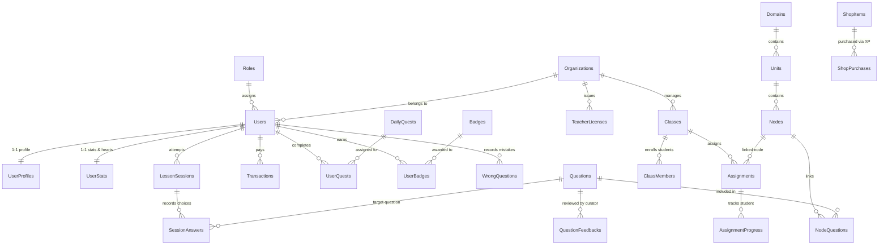

# MIMO EDUCATION PLATFORM — BÁO CÁO CƠ SỞ DỮ LIỆU & TỪ ĐIỂN DỮ LIỆU
**Môn học:** EXE201 — Khởi nghiệp công nghệ  
**Phần nộp:** Outcome 1 — Database Architecture & Specification  
**Hệ quản trị CSDL:** PostgreSQL 15 (Supabase Cloud, Singapore ap-southeast-1)  
**ORM Framework:** Entity Framework Core 9.0 (.NET 8 Clean Architecture)  
**Tổng số bảng chuẩn hóa:** 36 bảng nghiệp vụ  

---

## 1. TỔNG QUAN KIẾN TRÚC CƠ SỞ DỮ LIỆU
Cơ sở dữ liệu hệ thống **MIMO** được thiết kế theo chuẩn hóa bậc 3 (3NF), tối ưu hóa đồng thời cho 2 nhóm đối tượng khách hàng:
1. **B2C (Học sinh & Người học tự do):** Tương tác kịch bản xử lý tình huống khẩn cấp, hệ thống trừ tim khi trả lời sai, chuỗi ngày streak và bảng xếp hạng tuần.
2. **B2B (Ban Giám Hiệu & Giáo viên các trường học):** Quản lý lớp học, phân quyền giáo viên theo License Code, giao bài tập thực hành theo chủ đề PCCC/Y tế và theo dõi tỷ lệ hoàn thành.

Hệ thống bao gồm toàn bộ **36 bảng nghiệp vụ**, được chia thành 5 phân hệ thống nhất:
- **Phân hệ Core & Phân quyền (5 bảng):** `Roles`, `Users`, `UserProfiles`, `UserStats`, `Organizations`.
- **Phân hệ Kịch bản đào tạo & Gameplay Engine (9 bảng):** `Domains`, `Units`, `Nodes`, `Questions`, `NodeQuestions`, `LessonSessions`, `SessionAnswers`, `WrongQuestions`, `QuestionFeedbacks`.
- **Phân hệ Gamification & Retention (8 bảng):** `Badges`, `UserBadges`, `DailyQuests`, `UserQuests`, `ShopItems`, `ShopPurchases`, `XpEvents`, `UserNodeProgresses`.
- **Phân hệ B2B Trường học & Lớp học (5 bảng):** `Classes`, `ClassMembers`, `Assignments`, `AssignmentProgress`, `TeacherLicenses`.
- **Phân hệ Cẩm nang & Doanh thu (9 bảng):** `HandbookArticles`, `Transactions`, `Courses`, `Modules`, `Lessons`, `Enrollments`, `LessonProgresses`, `Certificates`, `Reviews`.

---

## 2. SƠ ĐỒ MỐI QUAN HỆ THỰC THỂ CỐT LÕI (CORE ERD)

---

## 3. TỪ ĐIỂN DỮ LIỆU CHI TIẾT 36 BẢNG (FULL DATA DICTIONARY)

### 1. Phân hệ Tài khoản, Tổ chức & Phân quyền (Core & RBAC)
*Quản lý 5 Role chuẩn hóa, danh tính người dùng, hồ sơ cá nhân, đơn vị trường học B2B và chỉ số Gamification sinh tồn (Hearts, Streak).*

#### Bảng 1: `Roles`
| Tên cột | Kiểu dữ liệu | Ràng buộc | Diễn giải nghiệp vụ |
| :--- | :--- | :--- | :--- |
| `Id` | `uuid` | **PK** | Mã định danh duy nhất (Primary Key) |
| `RoleName` | `character varying` | NOT NULL | Tên vai trò hệ thống: Admin, Student, Curator, Organization, Educator |
| `Description` | `character varying` | NULL | Mô tả chi tiết nội dung hoặc mục đích |
| `Status` | `text` | NOT NULL | Trạng thái hoạt động của đối tượng |
| `CreatedAt` | `timestamp with time zone` | NULL | Thời điểm khởi tạo bản ghi (UTC) |
| `UpdatedAt` | `timestamp with time zone` | NULL | Thời điểm cập nhật bản ghi gần nhất (UTC) |

#### Bảng 2: `Users`
| Tên cột | Kiểu dữ liệu | Ràng buộc | Diễn giải nghiệp vụ |
| :--- | :--- | :--- | :--- |
| `Id` | `uuid` | **PK** | Mã định danh duy nhất (Primary Key) |
| `RoleId` | `uuid` | **FK** -> `Roles(Id)`, NOT NULL | Khóa ngoại liên kết tới bảng Roles(Id) |
| `OrganizationId` | `uuid` | **FK** -> `Organizations(Id)`, NULL | Khóa ngoại liên kết tới bảng Organizations(Id) |
| `Name` | `character varying` | NOT NULL | Tên hiển thị / Danh xưng |
| `UserName` | `character varying` | NULL | Trường dữ liệu UserName của bảng Users |
| `Email` | `text` | NOT NULL | Địa chỉ email định danh đăng nhập |
| `Password` | `character varying` | NOT NULL | Mật khẩu đã được mã hóa an toàn (BCrypt/PBKDF2) |
| `Phone` | `character varying` | NULL | Số điện thoại liên hệ |
| `LastLogin` | `timestamp with time zone` | NULL | Trường dữ liệu LastLogin của bảng Users |
| `Address` | `character varying` | NULL | Địa chỉ liên hệ |
| `Status` | `text` | NOT NULL | Trạng thái hoạt động của đối tượng |
| `AuthType` | `character varying` | NULL | Phương thức xác thực (Local, Google) |
| `Avatar` | `character varying` | NULL | Đường dẫn ảnh đại diện người dùng |
| `RefreshToken` | `character varying` | NULL | Mã JWT Refresh Token cấp mới phiên truy cập |
| `RefreshTokenExpiryTime` | `timestamp with time zone` | NULL | Thời hạn hết hạn của Refresh Token |
| `CreatedAt` | `timestamp with time zone` | NULL | Thời điểm khởi tạo bản ghi (UTC) |
| `UpdatedAt` | `timestamp with time zone` | NULL | Thời điểm cập nhật bản ghi gần nhất (UTC) |
| `Timezone` | `character varying` | NOT NULL | Múi giờ người dùng (Mặc định: Asia/Ho_Chi_Minh) |
| `TotalXp` | `integer` | NOT NULL | Tổng điểm kinh nghiệm tích lũy |

#### Bảng 3: `UserProfiles`
| Tên cột | Kiểu dữ liệu | Ràng buộc | Diễn giải nghiệp vụ |
| :--- | :--- | :--- | :--- |
| `UserId` | `uuid` | **PK**, **FK** -> `Users(Id)` | Khóa ngoại liên kết tới bảng Users(Id) |
| `FullName` | `character varying` | NOT NULL | Họ và tên đầy đủ của người dùng |
| `AvatarUrl` | `character varying` | NULL | Đường dẫn ảnh đại diện lưu trữ trên Cloud Storage |
| `DailyGoalMinutes` | `integer` | NOT NULL | Mục tiêu học tập hàng ngày (phút) |
| `RiskSurveyResult` | `jsonb` | NULL | Kết quả khảo sát đánh giá chỉ số rủi ro ban đầu |
| `CreatedAt` | `timestamp with time zone` | NULL | Thời điểm khởi tạo bản ghi (UTC) |
| `UpdatedAt` | `timestamp with time zone` | NULL | Thời điểm cập nhật bản ghi gần nhất (UTC) |

#### Bảng 4: `UserStats`
| Tên cột | Kiểu dữ liệu | Ràng buộc | Diễn giải nghiệp vụ |
| :--- | :--- | :--- | :--- |
| `UserId` | `uuid` | **PK**, **FK** -> `Users(Id)` | Khóa ngoại liên kết tới bảng Users(Id) |
| `Hearts` | `integer` | NOT NULL | Số lượng trái tim sinh mệnh hiện có (tối đa 5 tim) |
| `HeartsUpdatedAt` | `timestamp with time zone` | NOT NULL | Thời điểm hồi phục trái tim gần nhất |
| `Streak` | `integer` | NOT NULL | Số ngày liên tiếp người dùng duy trì học tập |
| `LastActiveDate` | `date` | NULL | Ngày hoạt động gần nhất |
| `StreakFreezeCount` | `integer` | NOT NULL | Số lượng vật phẩm đóng băng chuỗi streak đang có |
| `IsPro` | `boolean` | NOT NULL | Trạng thái sở hữu gói thuê bao Mimo Pro |
| `ProExpiresAt` | `timestamp with time zone` | NULL | Thời hạn hết hạn của gói thuê bao Mimo Pro |

#### Bảng 5: `Organizations`
| Tên cột | Kiểu dữ liệu | Ràng buộc | Diễn giải nghiệp vụ |
| :--- | :--- | :--- | :--- |
| `Id` | `uuid` | **PK** | Mã định danh duy nhất (Primary Key) |
| `Name` | `character varying` | NOT NULL | Tên hiển thị / Danh xưng |
| `Code` | `character varying` | NOT NULL | Trường dữ liệu Code của bảng Organizations |
| `Email` | `character varying` | NOT NULL | Địa chỉ email định danh đăng nhập |
| `PhoneNumber` | `character varying` | NULL | Trường dữ liệu PhoneNumber của bảng Organizations |
| `Address` | `character varying` | NULL | Địa chỉ liên hệ |
| `SeatCount` | `integer` | NOT NULL | Trường dữ liệu SeatCount của bảng Organizations |
| `ExpirationDate` | `timestamp with time zone` | NULL | Trường dữ liệu ExpirationDate của bảng Organizations |
| `Status` | `text` | NOT NULL | Trạng thái hoạt động của đối tượng |
| `SubscriptionTier` | `text` | NOT NULL | Trường dữ liệu SubscriptionTier của bảng Organizations |
| `CreatedAt` | `timestamp with time zone` | NULL | Thời điểm khởi tạo bản ghi (UTC) |
| `UpdatedAt` | `timestamp with time zone` | NULL | Thời điểm cập nhật bản ghi gần nhất (UTC) |
| `UsedSeats` | `integer` | NOT NULL | Trường dữ liệu UsedSeats của bảng Organizations |

### 2. Phân hệ Gameplay Engine & Kịch bản tình huống
*Khung chương trình phân cấp (Domains -> Units -> Nodes), ngân hàng câu hỏi tương tác thực tế, ghi nhận đáp án học viên và kiểm duyệt kịch bản.*

#### Bảng 6: `Domains`
| Tên cột | Kiểu dữ liệu | Ràng buộc | Diễn giải nghiệp vụ |
| :--- | :--- | :--- | :--- |
| `Id` | `uuid` | **PK** | Mã định danh duy nhất (Primary Key) |
| `Name` | `character varying` | NOT NULL | Tên hiển thị / Danh xưng |
| `Slug` | `character varying` | NOT NULL | Trường dữ liệu Slug của bảng Domains |
| `IconUrl` | `text` | NULL | Trường dữ liệu IconUrl của bảng Domains |
| `Order` | `integer` | NOT NULL | Thứ tự ưu tiên hiển thị bài viết |
| `Status` | `character varying` | NOT NULL | Trạng thái hoạt động của đối tượng |
| `CreatedAt` | `timestamp with time zone` | NULL | Thời điểm khởi tạo bản ghi (UTC) |
| `UpdatedAt` | `timestamp with time zone` | NULL | Thời điểm cập nhật bản ghi gần nhất (UTC) |

#### Bảng 7: `Units`
| Tên cột | Kiểu dữ liệu | Ràng buộc | Diễn giải nghiệp vụ |
| :--- | :--- | :--- | :--- |
| `Id` | `uuid` | **PK** | Mã định danh duy nhất (Primary Key) |
| `DomainId` | `uuid` | **FK** -> `Domains(Id)`, NOT NULL | Khóa ngoại liên kết tới bảng Domains(Id) |
| `Title` | `character varying` | NOT NULL | Tiêu đề / Tên danh mục |
| `Description` | `text` | NULL | Mô tả chi tiết nội dung hoặc mục đích |
| `Order` | `integer` | NOT NULL | Thứ tự ưu tiên hiển thị bài viết |
| `CreatedAt` | `timestamp with time zone` | NULL | Thời điểm khởi tạo bản ghi (UTC) |
| `UpdatedAt` | `timestamp with time zone` | NULL | Thời điểm cập nhật bản ghi gần nhất (UTC) |

#### Bảng 8: `Nodes`
| Tên cột | Kiểu dữ liệu | Ràng buộc | Diễn giải nghiệp vụ |
| :--- | :--- | :--- | :--- |
| `Id` | `uuid` | **PK** | Mã định danh duy nhất (Primary Key) |
| `UnitId` | `uuid` | **FK** -> `Units(Id)`, NOT NULL | Khóa ngoại liên kết tới bảng Units(Id) |
| `Title` | `character varying` | NOT NULL | Tiêu đề / Tên danh mục |
| `Type` | `character varying` | NOT NULL | Loại câu hỏi (SingleChoice, MultipleChoice, OrderSequence) |
| `Order` | `integer` | NOT NULL | Thứ tự ưu tiên hiển thị bài viết |
| `UnlockRule` | `jsonb` | NULL | Trường dữ liệu UnlockRule của bảng Nodes |
| `XpReward` | `integer` | NOT NULL | Trường dữ liệu XpReward của bảng Nodes |
| `Status` | `character varying` | NOT NULL | Trạng thái hoạt động của đối tượng |
| `CreatedAt` | `timestamp with time zone` | NULL | Thời điểm khởi tạo bản ghi (UTC) |
| `UpdatedAt` | `timestamp with time zone` | NULL | Thời điểm cập nhật bản ghi gần nhất (UTC) |
| `CuratorId` | `uuid` | **FK** -> `Users(Id)`, NULL | Khóa ngoại liên kết tới tài khoản Chuyên gia |

#### Bảng 9: `Questions`
| Tên cột | Kiểu dữ liệu | Ràng buộc | Diễn giải nghiệp vụ |
| :--- | :--- | :--- | :--- |
| `Id` | `uuid` | **PK** | Mã định danh duy nhất (Primary Key) |
| `Type` | `character varying` | NOT NULL | Loại câu hỏi (SingleChoice, MultipleChoice, OrderSequence) |
| `Title` | `text` | NOT NULL | Tiêu đề / Tên danh mục |
| `ImageUrl` | `text` | NULL | Trường dữ liệu ImageUrl của bảng Questions |
| `Payload` | `jsonb` | NOT NULL | Trường dữ liệu Payload của bảng Questions |
| `CorrectData` | `jsonb` | NOT NULL | Trường dữ liệu CorrectData của bảng Questions |
| `Explanation` | `text` | NOT NULL | Lời giải thích khoa học / kỹ thuật PCCC/Y tế chuyên sâu |
| `Difficulty` | `character varying` | NOT NULL | Trường dữ liệu Difficulty của bảng Questions |
| `Source` | `character varying` | NULL | Trường dữ liệu Source của bảng Questions |
| `ReviewedBy` | `character varying` | NULL | Trường dữ liệu ReviewedBy của bảng Questions |
| `CuratorId` | `uuid` | **FK** -> `Users(Id)`, NULL | Khóa ngoại liên kết tới tài khoản Chuyên gia |
| `Status` | `character varying` | NOT NULL | Trạng thái hoạt động của đối tượng |
| `CreatedAt` | `timestamp with time zone` | NULL | Thời điểm khởi tạo bản ghi (UTC) |
| `UpdatedAt` | `timestamp with time zone` | NULL | Thời điểm cập nhật bản ghi gần nhất (UTC) |

#### Bảng 10: `NodeQuestions`
| Tên cột | Kiểu dữ liệu | Ràng buộc | Diễn giải nghiệp vụ |
| :--- | :--- | :--- | :--- |
| `NodeId` | `uuid` | **PK**, **FK** -> `Nodes(Id)` | Khóa ngoại liên kết tới bảng Nodes(Id) |
| `QuestionId` | `uuid` | **PK**, **FK** -> `Questions(Id)` | Khóa ngoại liên kết tới bảng Questions(Id) |
| `Order` | `integer` | NOT NULL | Thứ tự ưu tiên hiển thị bài viết |

#### Bảng 11: `LessonSessions`
| Tên cột | Kiểu dữ liệu | Ràng buộc | Diễn giải nghiệp vụ |
| :--- | :--- | :--- | :--- |
| `Id` | `uuid` | **PK** | Mã định danh duy nhất (Primary Key) |
| `UserId` | `uuid` | **FK** -> `Users(Id)`, NOT NULL | Khóa ngoại liên kết tới bảng Users(Id) |
| `NodeId` | `uuid` | **FK** -> `Nodes(Id)`, NOT NULL | Khóa ngoại liên kết tới bảng Nodes(Id) |
| `AssignmentId` | `uuid` | **FK** -> `Assignments(Id)`, NULL | Khóa ngoại liên kết tới bảng Assignments(Id) |
| `Status` | `character varying` | NOT NULL | Trạng thái hoạt động của đối tượng |
| `HeartsLost` | `integer` | NOT NULL | Số lượng trái tim bị trừ do trả lời sai |
| `TotalXpEarned` | `integer` | NOT NULL | Trường dữ liệu TotalXpEarned của bảng LessonSessions |
| `CurrentComboStreak` | `integer` | NOT NULL | Trường dữ liệu CurrentComboStreak của bảng LessonSessions |
| `MaxComboStreak` | `integer` | NOT NULL | Trường dữ liệu MaxComboStreak của bảng LessonSessions |
| `StartedAt` | `timestamp with time zone` | NOT NULL | Trường dữ liệu StartedAt của bảng LessonSessions |
| `ExpiresAt` | `timestamp with time zone` | NOT NULL | Thời hạn hết hạn của bản quyền giáo viên |
| `CompletedAt` | `timestamp with time zone` | NULL | Thời điểm hoàn thành nhiệm vụ |
| `CreatedAt` | `timestamp with time zone` | NULL | Thời điểm khởi tạo bản ghi (UTC) |
| `UpdatedAt` | `timestamp with time zone` | NULL | Thời điểm cập nhật bản ghi gần nhất (UTC) |

#### Bảng 12: `SessionAnswers`
| Tên cột | Kiểu dữ liệu | Ràng buộc | Diễn giải nghiệp vụ |
| :--- | :--- | :--- | :--- |
| `Id` | `uuid` | **PK** | Mã định danh duy nhất (Primary Key) |
| `SessionId` | `uuid` | **FK** -> `LessonSessions(Id)`, NOT NULL | Khóa ngoại liên kết tới bảng LessonSessions(Id) |
| `QuestionId` | `uuid` | **FK** -> `Questions(Id)`, NOT NULL | Khóa ngoại liên kết tới bảng Questions(Id) |
| `SubmittedAnswer` | `jsonb` | NOT NULL | Trường dữ liệu SubmittedAnswer của bảng SessionAnswers |
| `IsCorrect` | `boolean` | NOT NULL | Kết quả trả lời đúng hay sai |
| `TimeSpentSeconds` | `integer` | NOT NULL | Trường dữ liệu TimeSpentSeconds của bảng SessionAnswers |
| `XpEarned` | `integer` | NOT NULL | Số điểm XP được ghi nhận |
| `IdempotencyKey` | `character varying` | NULL | Trường dữ liệu IdempotencyKey của bảng SessionAnswers |
| `CreatedAt` | `timestamp with time zone` | NULL | Thời điểm khởi tạo bản ghi (UTC) |
| `UpdatedAt` | `timestamp with time zone` | NULL | Thời điểm cập nhật bản ghi gần nhất (UTC) |

#### Bảng 13: `WrongQuestions`
| Tên cột | Kiểu dữ liệu | Ràng buộc | Diễn giải nghiệp vụ |
| :--- | :--- | :--- | :--- |
| `Id` | `uuid` | **PK** | Mã định danh duy nhất (Primary Key) |
| `UserId` | `uuid` | **FK** -> `Users(Id)`, NOT NULL | Khóa ngoại liên kết tới bảng Users(Id) |
| `QuestionId` | `uuid` | **FK** -> `Questions(Id)`, NOT NULL | Khóa ngoại liên kết tới bảng Questions(Id) |
| `TimesWrong` | `integer` | NOT NULL | Số lần trả lời sai câu hỏi này trong quá khứ |
| `ResolvedAt` | `timestamp with time zone` | NULL | Thời điểm đã nắm vững kiến thức câu hỏi này |
| `LastAttemptAt` | `timestamp with time zone` | NOT NULL | Thời điểm làm lại câu hỏi gần nhất |
| `CreatedAt` | `timestamp with time zone` | NULL | Thời điểm khởi tạo bản ghi (UTC) |
| `UpdatedAt` | `timestamp with time zone` | NULL | Thời điểm cập nhật bản ghi gần nhất (UTC) |

#### Bảng 14: `QuestionFeedbacks`
| Tên cột | Kiểu dữ liệu | Ràng buộc | Diễn giải nghiệp vụ |
| :--- | :--- | :--- | :--- |
| `Id` | `uuid` | **PK** | Mã định danh duy nhất (Primary Key) |
| `QuestionId` | `uuid` | **FK** -> `Questions(Id)`, NOT NULL | Khóa ngoại liên kết tới bảng Questions(Id) |
| `ReviewerId` | `uuid` | **FK** -> `Users(Id)`, NULL | Trường dữ liệu ReviewerId của bảng QuestionFeedbacks |
| `ReviewerName` | `character varying` | NOT NULL | Trường dữ liệu ReviewerName của bảng QuestionFeedbacks |
| `Kind` | `character varying` | NOT NULL | Trường dữ liệu Kind của bảng QuestionFeedbacks |
| `Note` | `text` | NOT NULL | Ghi chú phân bổ bản quyền trường học |
| `Status` | `character varying` | NOT NULL | Trạng thái hoạt động của đối tượng |
| `ResolvedAt` | `timestamp with time zone` | NULL | Thời điểm đã nắm vững kiến thức câu hỏi này |
| `CreatedAt` | `timestamp with time zone` | NULL | Thời điểm khởi tạo bản ghi (UTC) |
| `UpdatedAt` | `timestamp with time zone` | NULL | Thời điểm cập nhật bản ghi gần nhất (UTC) |

### 3. Phân hệ Gamification, Nhiệm vụ & Cửa hàng
*Cơ chế kích thích hành vi học tập liên tục: Nhiệm vụ ngày (Daily Quests), Huy hiệu vinh danh (Badges), Cửa hàng vật phẩm và nhật ký điểm XP.*

#### Bảng 15: `Badges`
| Tên cột | Kiểu dữ liệu | Ràng buộc | Diễn giải nghiệp vụ |
| :--- | :--- | :--- | :--- |
| `Id` | `character varying` | **PK** | Mã định danh duy nhất (Primary Key) |
| `Title` | `character varying` | NOT NULL | Tiêu đề / Tên danh mục |
| `Category` | `character varying` | NOT NULL | Danh mục huy hiệu (PCCC, Sơ cấp cứu, Giao thông, Kiên trì) |
| `Description` | `text` | NOT NULL | Mô tả chi tiết nội dung hoặc mục đích |
| `Icon` | `character varying` | NOT NULL | Biểu tượng hiển thị (URL hoặc mã Icon Lucide/SVG) |
| `Rarity` | `character varying` | NOT NULL | Độ hiếm của huy hiệu (Phổ biến, Khá hiếm, Hiếm, Huyền thoại) |
| `CriteriaType` | `character varying` | NOT NULL | Tiêu chí mở khóa huy hiệu (XP_THRESHOLD, STREAK_DAYS, PERFECT_LESSONS) |
| `CriteriaValue` | `integer` | NOT NULL | Giá trị định lượng cần đạt để mở khóa |
| `CreatedAt` | `timestamp with time zone` | NOT NULL | Thời điểm khởi tạo bản ghi (UTC) |

#### Bảng 16: `UserBadges`
| Tên cột | Kiểu dữ liệu | Ràng buộc | Diễn giải nghiệp vụ |
| :--- | :--- | :--- | :--- |
| `Id` | `uuid` | **PK** | Mã định danh duy nhất (Primary Key) |
| `UserId` | `uuid` | **FK** -> `Users(Id)`, NOT NULL | Khóa ngoại liên kết tới bảng Users(Id) |
| `BadgeId` | `character varying` | **FK** -> `Badges(Id)`, NOT NULL | Khóa ngoại liên kết tới bảng Badges(Id) |
| `UnlockedAt` | `timestamp with time zone` | NOT NULL | Thời điểm người dùng đạt được huy hiệu |

#### Bảng 17: `DailyQuests`
| Tên cột | Kiểu dữ liệu | Ràng buộc | Diễn giải nghiệp vụ |
| :--- | :--- | :--- | :--- |
| `Id` | `uuid` | **PK** | Mã định danh duy nhất (Primary Key) |
| `Title` | `character varying` | NOT NULL | Tiêu đề / Tên danh mục |
| `QuestType` | `character varying` | NOT NULL | Loại nhiệm vụ ngày (COMPLETE_LESSON, PERFECT_SCORE, STREAK) |
| `Target` | `integer` | NOT NULL | Mục tiêu số lần cần đạt trong ngày |
| `RewardType` | `character varying` | NOT NULL | Loại phần thưởng khi hoàn thành (XP, HEART) |
| `RewardAmount` | `integer` | NOT NULL | Số lượng phần thưởng nhận được |
| `Icon` | `character varying` | NOT NULL | Biểu tượng hiển thị (URL hoặc mã Icon Lucide/SVG) |
| `IsActive` | `boolean` | NOT NULL | Trạng thái nhiệm vụ đang kích hoạt hay không |
| `CreatedAt` | `timestamp with time zone` | NULL | Thời điểm khởi tạo bản ghi (UTC) |
| `UpdatedAt` | `timestamp with time zone` | NULL | Thời điểm cập nhật bản ghi gần nhất (UTC) |

#### Bảng 18: `UserQuests`
| Tên cột | Kiểu dữ liệu | Ràng buộc | Diễn giải nghiệp vụ |
| :--- | :--- | :--- | :--- |
| `Id` | `uuid` | **PK** | Mã định danh duy nhất (Primary Key) |
| `UserId` | `uuid` | **FK** -> `Users(Id)`, NOT NULL | Khóa ngoại liên kết tới bảng Users(Id) |
| `QuestId` | `uuid` | **FK** -> `DailyQuests(Id)`, NOT NULL | Trường dữ liệu QuestId của bảng UserQuests |
| `DateKey` | `date` | NOT NULL | Trường dữ liệu DateKey của bảng UserQuests |
| `CurrentProgress` | `integer` | NOT NULL | Tiến độ thực tế người dùng đã hoàn thành |
| `IsCompleted` | `boolean` | NOT NULL | Đã hoàn thành mục tiêu nhiệm vụ hay chưa |
| `IsClaimed` | `boolean` | NOT NULL | Đã nhận phần thưởng hay chưa |
| `ClaimedAt` | `timestamp with time zone` | NULL | Trường dữ liệu ClaimedAt của bảng UserQuests |
| `CreatedAt` | `timestamp with time zone` | NULL | Thời điểm khởi tạo bản ghi (UTC) |
| `UpdatedAt` | `timestamp with time zone` | NULL | Thời điểm cập nhật bản ghi gần nhất (UTC) |

#### Bảng 19: `ShopItems`
| Tên cột | Kiểu dữ liệu | Ràng buộc | Diễn giải nghiệp vụ |
| :--- | :--- | :--- | :--- |
| `Id` | `character varying` | **PK** | Mã định danh duy nhất (Primary Key) |
| `Title` | `character varying` | NOT NULL | Tiêu đề / Tên danh mục |
| `Description` | `text` | NOT NULL | Mô tả chi tiết nội dung hoặc mục đích |
| `CostXp` | `integer` | NOT NULL | Giá mua vật phẩm tính bằng điểm XP |
| `Icon` | `character varying` | NOT NULL | Biểu tượng hiển thị (URL hoặc mã Icon Lucide/SVG) |
| `Color` | `character varying` | NULL | Mã màu đại diện của vật phẩm |
| `BgColor` | `character varying` | NULL | Mã màu nền hiển thị |
| `Status` | `character varying` | NOT NULL | Trạng thái hoạt động của đối tượng |
| `CreatedAt` | `timestamp with time zone` | NOT NULL | Thời điểm khởi tạo bản ghi (UTC) |

#### Bảng 20: `ShopPurchases`
| Tên cột | Kiểu dữ liệu | Ràng buộc | Diễn giải nghiệp vụ |
| :--- | :--- | :--- | :--- |
| `Id` | `uuid` | **PK** | Mã định danh duy nhất (Primary Key) |
| `UserId` | `uuid` | **FK** -> `Users(Id)`, NOT NULL | Khóa ngoại liên kết tới bảng Users(Id) |
| `ItemId` | `character varying` | **FK** -> `ShopItems(Id)`, NOT NULL | Trường dữ liệu ItemId của bảng ShopPurchases |
| `CostXp` | `integer` | NOT NULL | Giá mua vật phẩm tính bằng điểm XP |
| `PurchasedAt` | `timestamp with time zone` | NOT NULL | Trường dữ liệu PurchasedAt của bảng ShopPurchases |

#### Bảng 21: `XpEvents`
| Tên cột | Kiểu dữ liệu | Ràng buộc | Diễn giải nghiệp vụ |
| :--- | :--- | :--- | :--- |
| `Id` | `bigint` | **PK** | Mã định danh duy nhất (Primary Key) |
| `UserId` | `uuid` | **FK** -> `Users(Id)`, NOT NULL | Khóa ngoại liên kết tới bảng Users(Id) |
| `Amount` | `integer` | NOT NULL | Số tiền hoặc giá trị giao dịch |
| `Source` | `character varying` | NOT NULL | Trường dữ liệu Source của bảng XpEvents |
| `ReferenceId` | `uuid` | NULL | Trường dữ liệu ReferenceId của bảng XpEvents |
| `CreatedAt` | `timestamp with time zone` | NOT NULL | Thời điểm khởi tạo bản ghi (UTC) |

#### Bảng 22: `UserNodeProgresses`
| Tên cột | Kiểu dữ liệu | Ràng buộc | Diễn giải nghiệp vụ |
| :--- | :--- | :--- | :--- |
| `Id` | `uuid` | **PK** | Mã định danh duy nhất (Primary Key) |
| `UserId` | `uuid` | **FK** -> `Users(Id)`, NOT NULL | Khóa ngoại liên kết tới bảng Users(Id) |
| `NodeId` | `uuid` | **FK** -> `Nodes(Id)`, NOT NULL | Khóa ngoại liên kết tới bảng Nodes(Id) |
| `Status` | `character varying` | NOT NULL | Trạng thái hoạt động của đối tượng |
| `CompletedAt` | `timestamp with time zone` | NULL | Thời điểm hoàn thành nhiệm vụ |
| `CreatedAt` | `timestamp with time zone` | NULL | Thời điểm khởi tạo bản ghi (UTC) |
| `UpdatedAt` | `timestamp with time zone` | NULL | Thời điểm cập nhật bản ghi gần nhất (UTC) |

### 4. Phân hệ B2B Quản lý trường học & Lớp học (School Management)
*Mô hình triển khai cho các trường THCS/THPT: Quản lý lớp học, phân công giáo viên qua License Code, giao bài tập tình huống và giám sát tiến độ.*

#### Bảng 23: `Classes`
| Tên cột | Kiểu dữ liệu | Ràng buộc | Diễn giải nghiệp vụ |
| :--- | :--- | :--- | :--- |
| `Id` | `uuid` | **PK** | Mã định danh duy nhất (Primary Key) |
| `OrganizationId` | `uuid` | **FK** -> `Organizations(Id)`, NOT NULL | Khóa ngoại liên kết tới bảng Organizations(Id) |
| `EducatorId` | `uuid` | **FK** -> `Users(Id)`, NULL | Trường dữ liệu EducatorId của bảng Classes |
| `Name` | `character varying` | NOT NULL | Tên hiển thị / Danh xưng |
| `ClassCode` | `character varying` | NOT NULL | Mã tham gia lớp học (VD: FPT-K10, LHP-11B) |
| `Grade` | `character varying` | NULL | Khối lớp học (Khối 10, Khối 11, Khối 12) |
| `Room` | `character varying` | NULL | Phòng học / Khu vực sinh hoạt |
| `FocusTopic` | `character varying` | NULL | Chủ đề đào tạo an toàn trọng tâm của lớp |
| `MaxStudents` | `integer` | NOT NULL | Sĩ số học sinh tối đa của lớp học |
| `Status` | `character varying` | NOT NULL | Trạng thái hoạt động của đối tượng |
| `CreatedAt` | `timestamp with time zone` | NULL | Thời điểm khởi tạo bản ghi (UTC) |
| `UpdatedAt` | `timestamp with time zone` | NULL | Thời điểm cập nhật bản ghi gần nhất (UTC) |

#### Bảng 24: `ClassMembers`
| Tên cột | Kiểu dữ liệu | Ràng buộc | Diễn giải nghiệp vụ |
| :--- | :--- | :--- | :--- |
| `Id` | `uuid` | **PK** | Mã định danh duy nhất (Primary Key) |
| `ClassId` | `uuid` | **FK** -> `Classes(Id)`, NOT NULL | Khóa ngoại liên kết tới bảng Classes(Id) |
| `StudentId` | `uuid` | **FK** -> `Users(Id)`, NOT NULL | Khóa ngoại liên kết tới tài khoản Học sinh |
| `JoinedAt` | `timestamp with time zone` | NOT NULL | Thời điểm học sinh gia nhập lớp học |
| `Status` | `character varying` | NOT NULL | Trạng thái hoạt động của đối tượng |
| `CreatedAt` | `timestamp with time zone` | NULL | Thời điểm khởi tạo bản ghi (UTC) |
| `UpdatedAt` | `timestamp with time zone` | NULL | Thời điểm cập nhật bản ghi gần nhất (UTC) |

#### Bảng 25: `Assignments`
| Tên cột | Kiểu dữ liệu | Ràng buộc | Diễn giải nghiệp vụ |
| :--- | :--- | :--- | :--- |
| `Id` | `uuid` | **PK** | Mã định danh duy nhất (Primary Key) |
| `ClassId` | `uuid` | **FK** -> `Classes(Id)`, NOT NULL | Khóa ngoại liên kết tới bảng Classes(Id) |
| `NodeId` | `uuid` | **FK** -> `Nodes(Id)`, NOT NULL | Khóa ngoại liên kết tới bảng Nodes(Id) |
| `CreatedBy` | `uuid` | **FK** -> `Users(Id)`, NOT NULL | Mã người tạo bản ghi |
| `Title` | `character varying` | NOT NULL | Tiêu đề / Tên danh mục |
| `Description` | `text` | NULL | Mô tả chi tiết nội dung hoặc mục đích |
| `Deadline` | `timestamp with time zone` | NOT NULL | Hạn chót nộp bài tập tình huống |
| `PassScoreThreshold` | `integer` | NOT NULL | Mức điểm yêu cầu tối thiểu của bài tập |
| `RewardXp` | `integer` | NOT NULL | Điểm XP thưởng khi học sinh hoàn thành bài tập |
| `CreatedAt` | `timestamp with time zone` | NULL | Thời điểm khởi tạo bản ghi (UTC) |
| `UpdatedAt` | `timestamp with time zone` | NULL | Thời điểm cập nhật bản ghi gần nhất (UTC) |

#### Bảng 26: `AssignmentProgress`
| Tên cột | Kiểu dữ liệu | Ràng buộc | Diễn giải nghiệp vụ |
| :--- | :--- | :--- | :--- |
| `Id` | `uuid` | **PK** | Mã định danh duy nhất (Primary Key) |
| `AssignmentId` | `uuid` | **FK** -> `Assignments(Id)`, NOT NULL | Khóa ngoại liên kết tới bảng Assignments(Id) |
| `StudentId` | `uuid` | **FK** -> `Users(Id)`, NOT NULL | Khóa ngoại liên kết tới tài khoản Học sinh |
| `SessionId` | `uuid` | **FK** -> `LessonSessions(Id)`, NULL | Khóa ngoại liên kết tới bảng LessonSessions(Id) |
| `BestScore` | `integer` | NOT NULL | Trường dữ liệu BestScore của bảng AssignmentProgress |
| `IsPassed` | `boolean` | NOT NULL | Kết quả vượt qua chặng học hay chưa (Đạt >= PassScore) |
| `CompletedAt` | `timestamp with time zone` | NULL | Thời điểm hoàn thành nhiệm vụ |
| `CreatedAt` | `timestamp with time zone` | NULL | Thời điểm khởi tạo bản ghi (UTC) |
| `UpdatedAt` | `timestamp with time zone` | NULL | Thời điểm cập nhật bản ghi gần nhất (UTC) |

#### Bảng 27: `TeacherLicenses`
| Tên cột | Kiểu dữ liệu | Ràng buộc | Diễn giải nghiệp vụ |
| :--- | :--- | :--- | :--- |
| `Id` | `uuid` | **PK** | Mã định danh duy nhất (Primary Key) |
| `OrganizationId` | `uuid` | **FK** -> `Organizations(Id)`, NOT NULL | Khóa ngoại liên kết tới bảng Organizations(Id) |
| `ActivationCode` | `character varying` | NOT NULL | Mã bản quyền kích hoạt dành cho Giáo viên (VD: TEACH-FPT-2026) |
| `Note` | `character varying` | NULL | Ghi chú phân bổ bản quyền trường học |
| `AssignedClassesJson` | `jsonb` | NOT NULL | Mảng JSON danh sách ID các lớp học được phân công |
| `ClaimedByEducatorId` | `uuid` | **FK** -> `Users(Id)`, NULL | Trường dữ liệu ClaimedByEducatorId của bảng TeacherLicenses |
| `IsClaimed` | `boolean` | NOT NULL | Đã nhận phần thưởng hay chưa |
| `ExpiresAt` | `timestamp with time zone` | NOT NULL | Thời hạn hết hạn của bản quyền giáo viên |
| `CreatedAt` | `timestamp with time zone` | NULL | Thời điểm khởi tạo bản ghi (UTC) |
| `UpdatedAt` | `timestamp with time zone` | NULL | Thời điểm cập nhật bản ghi gần nhất (UTC) |

### 5. Phân hệ Cẩm nang tri thức, Doanh thu & Khóa học mở rộng
*Cẩm nang sơ cứu/thoát nạn chuẩn quốc gia, tích hợp cổng thanh toán trực tuyến VNPay ghi nhận giao dịch gói Pro và các bảng khóa học mở rộng.*

#### Bảng 28: `HandbookArticles`
| Tên cột | Kiểu dữ liệu | Ràng buộc | Diễn giải nghiệp vụ |
| :--- | :--- | :--- | :--- |
| `Id` | `character varying` | **PK** | Mã định danh duy nhất (Primary Key) |
| `Pillar` | `character varying` | NOT NULL | Trụ cột an toàn sinh tồn (PCCC, Giao thông, Sơ cứu, Chống bạo lực) |
| `Title` | `character varying` | NOT NULL | Tiêu đề / Tên danh mục |
| `Badge` | `character varying` | NOT NULL | Huy hiệu phân loại bài viết |
| `ReadTime` | `character varying` | NOT NULL | Thời lượng đọc ước tính (VD: 5 phút) |
| `EmergencyDials` | `jsonb` | NULL | Số điện thoại khẩn cấp liên quan (114, 115, 113) |
| `KeyProtocol` | `text` | NOT NULL | Quy trình xử lý khẩn cấp cốt lõi |
| `LegalBasis` | `text` | NOT NULL | Căn cứ pháp lý / Quy chuẩn Việt Nam liên quan |
| `ContentMarkdown` | `text` | NOT NULL | Nội dung chi tiết bài viết cẩm nang định dạng Markdown |
| `Order` | `integer` | NOT NULL | Thứ tự ưu tiên hiển thị bài viết |
| `CreatedAt` | `timestamp with time zone` | NOT NULL | Thời điểm khởi tạo bản ghi (UTC) |

#### Bảng 29: `Transactions`
| Tên cột | Kiểu dữ liệu | Ràng buộc | Diễn giải nghiệp vụ |
| :--- | :--- | :--- | :--- |
| `Id` | `uuid` | **PK** | Mã định danh duy nhất (Primary Key) |
| `UserId` | `uuid` | **FK** -> `Users(Id)`, NOT NULL | Khóa ngoại liên kết tới bảng Users(Id) |
| `CourseId` | `uuid` | **FK** -> `Courses(Id)`, NULL | Khóa ngoại liên kết tới khóa học |
| `Amount` | `numeric` | NOT NULL | Số tiền hoặc giá trị giao dịch |
| `Currency` | `character varying` | NOT NULL | Trường dữ liệu Currency của bảng Transactions |
| `PaymentMethod` | `text` | NOT NULL | Trường dữ liệu PaymentMethod của bảng Transactions |
| `TransactionDate` | `timestamp with time zone` | NOT NULL | Trường dữ liệu TransactionDate của bảng Transactions |
| `Status` | `text` | NOT NULL | Trạng thái hoạt động của đối tượng |
| `CreatedAt` | `timestamp with time zone` | NULL | Thời điểm khởi tạo bản ghi (UTC) |
| `UpdatedAt` | `timestamp with time zone` | NULL | Thời điểm cập nhật bản ghi gần nhất (UTC) |
| `BankCode` | `character varying` | NULL | Mã ngân hàng thực hiện thanh toán qua VNPay |
| `CompletedAt` | `timestamp with time zone` | NULL | Thời điểm hoàn thành nhiệm vụ |
| `OrderInfo` | `character varying` | NULL | Nội dung chi tiết giao dịch thanh toán (VD: Mua gói Mimo Pro) |
| `PlanCode` | `character varying` | NULL | Mã gói đăng ký (FREE, PREMIUM_6M, PREMIUM_1Y) |
| `TxnRef` | `character varying` | NOT NULL | Trường dữ liệu TxnRef của bảng Transactions |
| `VnpayResponseCode` | `character varying` | NULL | Trường dữ liệu VnpayResponseCode của bảng Transactions |
| `VnpayTransactionNo` | `character varying` | NULL | Trường dữ liệu VnpayTransactionNo của bảng Transactions |

#### Bảng 30: `Courses`
| Tên cột | Kiểu dữ liệu | Ràng buộc | Diễn giải nghiệp vụ |
| :--- | :--- | :--- | :--- |
| `Id` | `uuid` | **PK** | Mã định danh duy nhất (Primary Key) |
| `InstructorId` | `uuid` | **FK** -> `Users(Id)`, NOT NULL | Trường dữ liệu InstructorId của bảng Courses |
| `Title` | `character varying` | NOT NULL | Tiêu đề / Tên danh mục |
| `Category` | `character varying` | NOT NULL | Danh mục huy hiệu (PCCC, Sơ cấp cứu, Giao thông, Kiên trì) |
| `DifficultyLevel` | `text` | NOT NULL | Trường dữ liệu DifficultyLevel của bảng Courses |
| `Price` | `numeric` | NOT NULL | Giá bán vật phẩm |
| `Status` | `text` | NOT NULL | Trạng thái hoạt động của đối tượng |
| `CreatedAt` | `timestamp with time zone` | NULL | Thời điểm khởi tạo bản ghi (UTC) |
| `UpdatedAt` | `timestamp with time zone` | NULL | Thời điểm cập nhật bản ghi gần nhất (UTC) |

#### Bảng 31: `Modules`
| Tên cột | Kiểu dữ liệu | Ràng buộc | Diễn giải nghiệp vụ |
| :--- | :--- | :--- | :--- |
| `Id` | `uuid` | **PK** | Mã định danh duy nhất (Primary Key) |
| `CourseId` | `uuid` | **FK** -> `Courses(Id)`, NOT NULL | Khóa ngoại liên kết tới khóa học |
| `Title` | `character varying` | NOT NULL | Tiêu đề / Tên danh mục |
| `OrderIndex` | `integer` | NOT NULL | Thứ tự hiển thị trên giao diện người dùng |
| `CreatedAt` | `timestamp with time zone` | NULL | Thời điểm khởi tạo bản ghi (UTC) |
| `UpdatedAt` | `timestamp with time zone` | NULL | Thời điểm cập nhật bản ghi gần nhất (UTC) |

#### Bảng 32: `Lessons`
| Tên cột | Kiểu dữ liệu | Ràng buộc | Diễn giải nghiệp vụ |
| :--- | :--- | :--- | :--- |
| `Id` | `uuid` | **PK** | Mã định danh duy nhất (Primary Key) |
| `ModuleId` | `uuid` | **FK** -> `Modules(Id)`, NOT NULL | Khóa ngoại liên kết tới học phần |
| `Title` | `character varying` | NOT NULL | Tiêu đề / Tên danh mục |
| `ContentType` | `text` | NOT NULL | Trường dữ liệu ContentType của bảng Lessons |
| `DurationSeconds` | `integer` | NOT NULL | Thời gian thực tế giải quyết tình huống (giây) |
| `CreatedAt` | `timestamp with time zone` | NULL | Thời điểm khởi tạo bản ghi (UTC) |
| `UpdatedAt` | `timestamp with time zone` | NULL | Thời điểm cập nhật bản ghi gần nhất (UTC) |

#### Bảng 33: `Enrollments`
| Tên cột | Kiểu dữ liệu | Ràng buộc | Diễn giải nghiệp vụ |
| :--- | :--- | :--- | :--- |
| `Id` | `uuid` | **PK** | Mã định danh duy nhất (Primary Key) |
| `UserId` | `uuid` | **FK** -> `Users(Id)`, NOT NULL | Khóa ngoại liên kết tới bảng Users(Id) |
| `CourseId` | `uuid` | **FK** -> `Courses(Id)`, NOT NULL | Khóa ngoại liên kết tới khóa học |
| `EnrollmentDate` | `timestamp with time zone` | NOT NULL | Trường dữ liệu EnrollmentDate của bảng Enrollments |
| `CompletionPercent` | `real` | NOT NULL | Trường dữ liệu CompletionPercent của bảng Enrollments |
| `Status` | `text` | NOT NULL | Trạng thái hoạt động của đối tượng |
| `CreatedAt` | `timestamp with time zone` | NULL | Thời điểm khởi tạo bản ghi (UTC) |
| `UpdatedAt` | `timestamp with time zone` | NULL | Thời điểm cập nhật bản ghi gần nhất (UTC) |

#### Bảng 34: `LessonProgresses`
| Tên cột | Kiểu dữ liệu | Ràng buộc | Diễn giải nghiệp vụ |
| :--- | :--- | :--- | :--- |
| `Id` | `uuid` | **PK** | Mã định danh duy nhất (Primary Key) |
| `EnrollmentId` | `uuid` | **FK** -> `Enrollments(Id)`, NOT NULL | Trường dữ liệu EnrollmentId của bảng LessonProgresses |
| `LessonId` | `uuid` | **FK** -> `Lessons(Id)`, NOT NULL | Khóa ngoại liên kết tới bài học |
| `LastWatchedSec` | `integer` | NOT NULL | Trường dữ liệu LastWatchedSec của bảng LessonProgresses |
| `Status` | `text` | NOT NULL | Trạng thái hoạt động của đối tượng |
| `Score` | `real` | NULL | Điểm số đạt được trong phiên làm bài |
| `CreatedAt` | `timestamp with time zone` | NULL | Thời điểm khởi tạo bản ghi (UTC) |
| `UpdatedAt` | `timestamp with time zone` | NULL | Thời điểm cập nhật bản ghi gần nhất (UTC) |

#### Bảng 35: `Certificates`
| Tên cột | Kiểu dữ liệu | Ràng buộc | Diễn giải nghiệp vụ |
| :--- | :--- | :--- | :--- |
| `Id` | `uuid` | **PK** | Mã định danh duy nhất (Primary Key) |
| `EnrollmentId` | `uuid` | **FK** -> `Enrollments(Id)`, NOT NULL | Trường dữ liệu EnrollmentId của bảng Certificates |
| `IssueDate` | `timestamp with time zone` | NOT NULL | Trường dữ liệu IssueDate của bảng Certificates |
| `PdfUrl` | `character varying` | NOT NULL | Trường dữ liệu PdfUrl của bảng Certificates |
| `CreatedAt` | `timestamp with time zone` | NULL | Thời điểm khởi tạo bản ghi (UTC) |
| `UpdatedAt` | `timestamp with time zone` | NULL | Thời điểm cập nhật bản ghi gần nhất (UTC) |

#### Bảng 36: `Reviews`
| Tên cột | Kiểu dữ liệu | Ràng buộc | Diễn giải nghiệp vụ |
| :--- | :--- | :--- | :--- |
| `Id` | `uuid` | **PK** | Mã định danh duy nhất (Primary Key) |
| `UserId` | `uuid` | **FK** -> `Users(Id)`, NOT NULL | Khóa ngoại liên kết tới bảng Users(Id) |
| `CourseId` | `uuid` | **FK** -> `Courses(Id)`, NOT NULL | Khóa ngoại liên kết tới khóa học |
| `Rating` | `integer` | NOT NULL | Điểm đánh giá sao (1-5 sao) |
| `Comment` | `text` | NULL | Lời bình luận nhận xét |
| `CreatedAt` | `timestamp with time zone` | NULL | Thời điểm khởi tạo bản ghi (UTC) |
| `UpdatedAt` | `timestamp with time zone` | NULL | Thời điểm cập nhật bản ghi gần nhất (UTC) |

---

## 4. THÔNG TIN KẾT NỐI VÀ XÁC THỰC DÀNH CHO GIẢNG VIÊN
- **Môn học:** EXE201 — Khởi nghiệp công nghệ (Outcome 1)
- **Supabase Cloud Project URL:** `https://supabase.com/dashboard/project/dbrjefhuxkgywouawfgh`
- **Database Engine:** PostgreSQL 15 (ap-southeast-1, Singapore)
- **Quyền truy cập:** Nhóm đã gửi lời mời truy cập (Role Viewer/Developer) vào email giảng viên.
- **Tính toàn vẹn CSDL:** Toàn bộ 7/7 Migration đã đồng bộ hoàn chỉnh trên bảng `__EFMigrationsHistory`.
