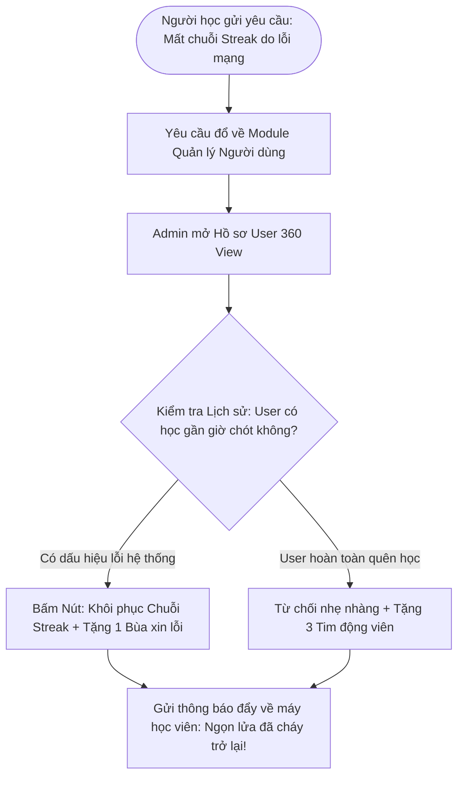

# TÀI LIỆU ĐẶC TẢ CHI TIẾT PHÂN HỆ: QUẢN TRỊ VIÊN & VẬN HÀNH (ADMIN & OPERATIONS)
## NỀN TẢNG HỌC KỸ NĂNG SỐNG & AN TOÀN GAMIFIED — MIMO PLATFORM

> **Dự án:** EXE201 — Khởi nghiệp & Phát triển Sản phẩm  
> **Phân hệ:** Quản trị & Điều hành Hệ thống (Admin Portal / Internal CMS & Ops)  
> **Mục tiêu:** Đặc tả chi tiết 100% cấu trúc giao diện, thanh công cụ, các phân hệ chức năng, luồng nghiệp vụ quản lý nội dung tình huống, kiểm soát thông số Game hóa, chăm sóc người dùng và quản lý trường học B2B.

---

## MỤC LỤC
1. [TỔNG QUAN PHÂN HỆ & CẤP QUYỀN HỆ THỐNG (RBAC)](#1-tổng-quan-phân-hệ--cấp-quyền-hệ-thống-rbac)
2. [KIẾN TRÚC GIAO DIỆN ADMIN (PORTAL LAYOUT)](#2-kiến-trúc-giao-diện-admin-portal-layout)
3. [MODULE 1: BẢNG ĐIỀU KHIỂN & BÁO CÁO PHÂN TÍCH (DASHBOARD & ANALYTICS)](#3-module-1-bảng-điều-khiển--báo-cáo-phân-tích-dashboard--analytics)
4. [MODULE 2: BỘ SOẠN THẢO KỊCH BẢN TÌNH HUỐNG (SCENARIO BUILDER / CMS)](#4-module-2-bộ-soạn-thảo-kịch-bản-tình-huống-scenario-builder--cms)
5. [MODULE 3: BỘ CẤU HÌNH CÂN BẰNG GAME HÓA (GAMIFICATION BALANCING ENGINE)](#5-module-3-bộ-cấu-hình-cân-bằng-game-hóa-gamification-balancing-engine)
6. [MODULE 4: QUẢN LÝ NGƯỜI DÙNG & HỖ TRỢ KHÁCH HÀNG (USER MANAGEMENT & SUPPORT)](#6-module-4-quản-lý-người-dùng--hỗ-trợ-khách-hàng-user-management--support)
7. [MODULE 5: QUẢN LÝ TRƯỜNG HỌC & GIẤY PHÉP B2B (SCHOOLS & B2B LICENSES)](#7-module-5-quản-lý-trường-học--giấy-phép-b2b-schools--b2b-licenses)
8. [MODULE 6: TRUNG TÂM TIẾP NHẬN BÁO LỖI & PHẢN HỒI (FEEDBACK & INCIDENTS)](#8-module-6-trung-tâm-tiếp-nhận-báo-lỗi--phản-hồi-feedback--incidents)
9. [MODULE 7: QUẢN LÝ DOANH THU & GÓI CƯỚC (BILLING & MONETIZATION)](#9-module-7-quản-lý-doanh-thu--gói-cước-billing--monetization)
10. [CÁC LUỒNG XỬ LÝ NGHIỆP VỤ TIÊU BIỂU CỦA ADMIN](#10-các-luồng-xử-lý-nghiệp-vụ-tiêu-biểu-của-admin)

---

## 1. TỔNG QUAN PHÂN HỆ & CẤP QUYỀN HỆ THỐNG (RBAC)

### 1.1. Sứ mệnh của Phân hệ Quản trị MIMO
Khác với các sàn khóa học mở (như Udemy) cho phép bất kỳ ai tự do đăng tải video, nền tảng **MIMO giáo dục về an toàn sinh tồn, y tế và pháp luật**. Do đó, nội dung phải được **quản lý tập trung, chuẩn hóa chuyên môn và kiểm duyệt nghiêm ngặt** trước khi đến tay người học.

Admin Portal là trung tâm chỉ huy (Command Center) phục vụ 4 mục tiêu sống còn:
1. **Bảo đảm chuẩn y khoa & an toàn:** Soạn thảo, thẩm định và cập nhật kịch bản theo khuyến cáo mới nhất của Hội Chữ Thập Đỏ, Cục PCCC & Bộ Công An.
2. **Kiểm soát động lực giữ chân (Retention):** Cân bằng độ khó của bài học, tần suất hồi Tim, tỷ lệ rớt hạng giải đấu để người học không bị nản chí.
3. **Phát hiện "vùng mù" kiến thức cộng đồng (Skill Gap Analytics):** Nhìn vào dữ liệu để biết học sinh đang chọn sai tình huống nào nhiều nhất.
4. **Vận hành thương mại & B2B:** Quản lý tài khoản trường học, cấp phép gói bản quyền và xử lý khiếu nại.

---

### 1.2. Vị trí của Admin trong Kiến trúc 4 Roles Toàn diện

Hệ thống MIMO được xây dựng dựa trên mô hình **4 Roles độc lập, chuyên nghiệp**:
1. **Student (Học viên B2C):** Học trên app, chơi game phản xạ, giữ streak, đua top.
2. **Curator (Giảng viên / Chuyên gia Biên soạn):** Bác sĩ, chuyên gia an toàn vào **Curator Studio** độc lập để sáng tạo kịch bản, viết giải thích y tế và thẩm định nội dung. *(Đặc tả chi tiết tại tài liệu riêng: Dac_Ta_Chi_Tiet_Phan_He_Curator_Studio.md)*.
3. **Organization (Nhà trường / Doanh nghiệp B2B):** Hiệu trưởng, giáo viên vào **School Portal** để quản lý lớp, giao bài tập tuần và xuất báo cáo Sở GD&ĐT. *(Đặc tả chi tiết tại tài liệu riêng: Dac_Ta_Chi_Tiet_Phan_He_Nha_Truong_Educator.md)*.
4. **Admin (Chủ hệ thống / Vận hành & Quyết định Tối cao):** Điều phối toàn bộ nền tảng, quản lý tài chính doanh thu, hợp đồng trường học, cấu hình hệ số game hóa, và **phê duyệt xuất bản lần cuối (Final signoff)** các kịch bản do Curator gửi lên.

```
┌────────────────────────────────────────────────────────────────────────┐
│                     HỆ THỐNG PHÂN QUYỀN NỘI BỘ ADMIN                   │
└────────────────────────────────────────────────────────────────────────┘
          │                                 │                    │
          ▼                                 ▼                    ▼
   [ 👑 SUPER ADMIN ]            [ 💼 B2B & PARTNERSHIP ]  [ 🎧 CSKH & OPS MOD ]
   • Quản trị toàn quyền         • Quản lý trường học     • Hỗ trợ người học
   • Cấu hình hệ số Gamification • Ký hợp đồng bản quyền  • Cứu chuỗi Streak lỗi
   • Quản lý tài chính, Payout   • Cấp tài khoản Curator   • Tiếp nhận báo lỗi bug
   • Phê duyệt xuất bản bài học  • Quản lý mã kích hoạt   • Xử lý gian lận điểm XP
```

* **👑 Super Admin (Ban Sáng Lập / Giám Đốc Vận Hành):** Có quyền cao nhất; cấu hình tham số hệ thống, phê duyệt kịch bản lên môi trường Production, xem báo cáo doanh thu tài chính nhạy cảm.
* **💼 B2B & Partnership Manager (Quản lý Đối tác & Trường học):** Chịu trách nhiệm tạo hợp đồng trường học, sinh dải mã lớp, và cấp tài khoản Curator cho các bác sĩ/chuyên gia đối tác.
* **🎧 CSKH & Community Moderator (Điều hành & Hỗ trợ):** Tiếp nhận khiếu nại đứt chuỗi streak, hỗ trợ cấp lại tim khi gặp sự cố, xử lý tài khoản gian lận bot click.

---

## 2. KIẾN TRÚC GIAO DIỆN ADMIN (PORTAL LAYOUT)

Giao diện Admin được thiết kế theo phong cách Modern SaaS Dashboard (sạch sẽ, độ tương phản cao, hỗ trợ làm việc liên tục không mỏi mắt):

```
┌────────────────────────────────────────────────────────────────────────────────────────┐
│  [MIMO ADMIN] 🔍 Tìm kiếm toàn cục (User, Bài học, Mã trường...)   🔔 (3) 🌙 [Admin Avt]│
├───────────────────┬────────────────────────────────────────────────────────────────────┤
│ SIDEBAR (240px)   │ KHÔNG GIAN LÀM VIỆC CHÍNH (MAIN WORKSPACE - ĐỘ RỘNG CO DÃN)        │
├───────────────────┤                                                                    │
│ 📊 Tổng quan      │  [HÀNG THẺ CHỈ SỐ: DAU • RETENTION D7 • LIVES SAVED • DOANH THU]  │
│ 🧩 Quản lý Nội dung│                                                                    │
│ 🎮 Cân bằng Game  │  [BIỂU ĐỒ TĂNG TRƯỞNG & BẢN ĐỒ VÙNG NGUY HIỂM HỌC SINH SAI NHIỀU]  │
│ 👥 Người dùng     │                                                                    │
│ 🏫 Trường học B2B │  [BẢNG CẢNH BÁO TÌNH HUỐNG CÓ TỶ LỆ THẤT BẠI BẤT THƯỜNG (>60% SAI)]│
│ 💬 Báo lỗi & Góp ý│                                                                    │
│ 💰 Doanh thu      │                                                                    │
│ ⚙️ Cài đặt hệ thống│                                                                    │
└───────────────────┴────────────────────────────────────────────────────────────────────┘
```

---

## 3. MODULE 1: BẢNG ĐIỀU KHIỂN & BÁO CÁO PHÂN TÍCH (DASHBOARD & ANALYTICS)

Đây là màn hình xuất hiện đầu tiên khi Admin đăng nhập, hiển thị "nhịp đập sức khỏe" của toàn bộ hệ thống trong 24 giờ qua:

### 3.1. Bộ Chỉ số Sống còn (North Star Metrics Cards)
1. **DAU / MAU (Daily / Monthly Active Users):**
   * Hiển thị: Số lượng người học vào app hôm nay (vd: `12.450 DAU`) kèm tỷ lệ tăng trưởng so với tuần trước (+14.2%).
   * Hệ số dính (Stickiness = DAU / MAU): Đạt chuẩn EdTech nếu > 20%.
2. **Tỷ lệ Giữ chân Chuỗi ngày (Streak Retention Rate):**
   * Tỷ lệ người học duy trì chuỗi Streak trên 7 ngày (`D7 Retention: 42%`) và trên 30 ngày (`D30: 21%`).
3. **Số Nạn nhân Giả lập được Cứu sống (Simulated Lives Saved):**
   * Chỉ số tự hào của dự án: Tổng số lượt giải quyết tình huống khẩn cấp thành công (vd: `148.920 lượt`).
4. **Doanh thu Định kỳ Hàng tháng (MRR - Monthly Recurring Revenue):**
   * Tổng tiền thu được từ thuê bao B2C Mimo Pro + Hợp đồng B2B trường học (vd: `86.500.000 VNĐ`).

---

### 3.2. Bản đồ Nhiệt Vùng mù Kiến thức (Safety Skill Gap Heatmap)
Tính năng phân tích dữ liệu chuyên sâu giúp nhóm bảo vệ xuất sắc trước hội đồng EXE201:

```
┌────────────────────────────────────────────────────────────────────────┐
│ BÁO CÁO VÙNG MÙ KIẾN THỨC AN TOÀN TRONG CỘNG ĐỒNG HỌC VIÊN             │
├────────────────────────────────┬──────────────────┬────────────────────┤
│ Chủ đề Kỹ năng                 │ Tỷ lệ làm ĐÚNG   │ Đánh giá rủi ro    │
├────────────────────────────────┼──────────────────┼────────────────────┤
│ 1. Thoát hiểm khi rò rỉ khí gas│ 88%              │ 🟢 An toàn cao     │
│ 2. Nhận diện link Scam trúng th│ 74%              │ 🟡 Trung bình      │
│ 3. Sơ cứu hóc dị vật Heimlich  │ 52%              │ 🟠 Cảnh báo        │
│ 4. SƠ CỨU BỎNG NƯỚC SÔI        │ 31% (69% CHỌN SAI│ 🔴 NGUY HIỂM CAO!  │
└────────────────────────────────┴──────────────────┴────────────────────┘
```
* **Ý nghĩa thực tế:** Hệ thống phát hiện **69% người học vẫn có thói quen bôi kem đánh răng hoặc mỡ trăn vào vết bỏng**. 
* **Hành động của Admin:** Bấm 1 nút ➔ Lập tức đẩy thông báo thông điệp cảnh báo an toàn về điện thoại của toàn bộ 12.000 học viên để đính chính kiến thức!

---

## 4. MODULE 2: QUẢN LÝ PHÊ DUYỆT BÀI HỌC & CẤP QUYỀN CURATOR (CONTENT APPROVAL & CURATOR GOVERNANCE)

> 💡 **Lưu ý phân quyền:** Toàn bộ công việc trực tiếp sáng tạo nội dung, chọn ảnh minh họa và viết lời giải thích chuyên môn được thực hiện bởi các Chuyên gia trong **Curator Studio** (được đặc tả riêng tại file: `Dac_Ta_Chi_Tiet_Phan_He_Curator_Studio.md`).  
> Tại Admin Portal, Super Admin đóng vai trò là **"Người Gác Cổng Tối Cao" (The Gatekeeper)** chịu trách nhiệm kiểm duyệt cuối cùng trước khi đưa bài học lên môi trường thực tế (Production).

```
┌────────────────────────────────────────────────────────────────────────┐
│ HÀNG CHỜ PHÊ DUYỆT BÀI HỌC (CONTENT APPROVAL QUEUE)                    │
├──────────────────────┬───────────────┬──────────────┬──────────────────┤
│ Tên Bài học          │ Chuyên đề     │ Curator biên │ Trạng thái       │
├──────────────────────┼───────────────┼──────────────┼──────────────────┤
│ 1. Thoát hiểm chung c│ PCCC & Khói   │ Đ/c Lê Tuấn  │ ⏳ Chờ Admin duyệt│
│ 2. Sơ cứu ngưng tim  │ Sơ cấp cứu    │ BS. Hoàng Nam│ ⏳ Chờ Admin duyệt│
│ 3. Deepfake lừa đảo  │ An toàn số    │ KS. Minh Anh │ 🟢 Đã duyệt Live │
└──────────────────────┴───────────────┴──────────────┴──────────────────┤
│ [ 👁️ XEM THỬ TRÊN GIẢ LẬP ]   [ ✅ DUYỆT PHÁT HÀNH ]   [ ❌ YÊU CẦU SỬA ] │
└────────────────────────────────────────────────────────────────────────┘
```

### 4.1. Hàng chờ Phê duyệt Kịch bản (Pending Review Queue)
* Khi Curator hoàn thành bài học và bấm *"Gửi thẩm định xuất bản"*, bài học sẽ xuất hiện trong Hàng chờ của Admin.
* Admin bấm **"Xem thử trên giả lập"** để trải nghiệm thực tế bộ câu hỏi.
* Nếu đạt chuẩn chất lượng: Admin bấm **"Duyệt phát hành (Publish Live)"** ➔ Bài học lập tức xuất hiện trên Bản đồ của học viên toàn hệ thống.
* Nếu chưa đạt: Admin bấm **"Yêu cầu chỉnh sửa (Reject with Notes)"** ➔ Nhập phản hồi gửi ngược về Curator Studio kèm yêu cầu cụ thể (vd: *"Ảnh câu 3 dung lượng quá nặng, đề nghị nén lại"*).

### 4.2. Quản lý Đội ngũ Chuyên gia (Curator Roster & Domain Assignment)
* Admin có thẩm quyền mời và cấp tài khoản Curator cho các chuyên gia đối tác (Bác sĩ, Cảnh sát PCCC, Giảng viên kỹ năng sống).
* **Phân bổ chuyên môn nghiêm ngặt:** Bác sĩ A chỉ được cấp quyền biên soạn trong chuyên đề *Sơ cấp cứu*; Cảnh sát B chỉ được biên soạn chuyên đề *PCCC*. Tránh việc can thiệp chéo trái chuyên môn.

### 4.3. Thu hồi Khẩn cấp (Emergency Rollback)
* Trong trường hợp một bài học đã xuất bản nhưng bị phát hiện có sai sót y khoa hoặc có văn bản pháp luật mới, Admin có quyền bấm **"Tạm khóa bài học (Emergency Rollback)"** chỉ trong 1 cú click để ẩn bài khỏi học viên ngay lập tức trong khi chờ Curator cập nhật lại phác đồ.

---

## 5. MODULE 3: BỘ CẤU HÌNH CÂN BẰNG GAME HÓA (GAMIFICATION BALANCING ENGINE)

Một trong những lý do Duolingo thành công là họ liên tục tinh chỉnh các tham số tâm lý học hành vi. Mimo cung cấp trang cấu hình tập trung cho phép Admin điều chỉnh độ khó mà không cần sửa code:

```
┌────────────────────────────────────────────────────────────────────────┐
│ BẢNG ĐIỀU CHỈNH THAM SỐ CÂN BẰNG GAME HÓA (SYSTEM TUNING)              │
├────────────────────────────────────────────────────────────────────────┤
│ 1. CƠ CHẾ TIM (HEARTS SYSTEM):                                         │
│    • Số tim tối đa: [ 5 ] quả                                          │
│    • Thời gian tự hồi phục 1 tim: [ 240 ] phút (4 tiếng)               │
│    • Số câu ôn tập đúng để hồi 1 tim: [ 3 ] câu                        │
│    • Giá hồi đầy 5 tim bằng điểm: [ 150 ] XP                           │
│                                                                        │
│ 2. CƠ CHẾ CHUỖI NGÀY (DAILY STREAK):                                   │
│    • Điều kiện hoàn thành ngày: Tối thiểu [ 1 ] bài học bất kỳ         │
│    • Giá mua 1 Bùa Đóng Băng Chuỗi: [ 200 ] XP                         │
│    • Giới hạn bùa tối đa 1 tài khoản được trữ: [ 2 ] bùa               │
│                                                                        │
│ 3. CƠ CHẾ GIẢI ĐẤU HÀNG TUẦN (LEAGUES):                                │
│    • Quy mô 1 bảng đấu: [ 30 ] người ngẫu nhiên cùng trình độ          │
│    • Tỷ lệ thăng hạng: Top [ 7 ] người đứng đầu                        │
│    • Tỷ lệ rớt hạng: Top [ 5 ] người cuối bảng                         │
│    • Rương thưởng Top 1 tuần: [ 100 XP + Huy hiệu Độc quyền ]          │
│                                                                        │
│ [ CẬP NHẬT TOÀN HỆ THỐNG ]                        [ KHÔI PHỤC MẶC ĐỊNH]│
└────────────────────────────────────────────────────────────────────────┘
```

---

## 6. MODULE 4: QUẢN LÝ NGƯỜI DÙNG & HỖ TRỢ KHÁCH HÀNG (USER MANAGEMENT & SUPPORT)

### 6.1. Danh sách Người dùng Toàn hệ thống
* **Bộ lọc thông minh:** Lọc theo Email, Tên, Trường học, Số ngày Streak (>30 ngày), Trạng thái tài khoản (Free / Mimo Pro), hoặc Cảnh báo gian lận.
* **Bảng dữ liệu hiển thị:** Avatar, Tên, Email, Ngày tham gia, Chuỗi Streak, Tổng XP, Cấp bậc, Trạng thái (Active / Banned).

---

### 6.2. Hồ sơ Chi tiết Người học (User 360 Degree View)
Khi click vào một người học bất kỳ, Admin xem được toàn bộ hành vi:
* Biểu đồ thời gian học trong 30 ngày qua.
* Lịch sử trừ tim và các câu hỏi mà người này hay chọn sai.
* Danh sách huy hiệu đã đạt.

---

### 6.3. Bộ Công cụ Can thiệp Hỗ trợ Nhanh (Customer Support Action Tools)
Nhân viên CSKH có các nút bấm đặc quyền để xử lý khiếu nại của người dùng:
* **🔥 Cứu chuỗi Streak (Rescue Streak):** 
  * *Nghiệp vụ:* Khi người học khiếu nại (ví dụ: *"Hôm qua app bị lỗi mạng lúc 23:50 làm em mất chuỗi 45 ngày"*), Admin kiểm tra log và bấm nút *"Khôi phục Chuỗi"* chỉ trong 1 giây.
* **❤️ Nạp đầy Tim khẩn cấp:** Cấp ngay 5 tim miễn phí cho người dùng.
* **🎁 Tặng Bùa Đóng Băng / Cộng điểm XP thưởng:** Dùng làm quà đền bù khi người dùng phát hiện lỗi chính tả hoặc lỗi nội dung kịch bản.
* **🚫 Khóa tài khoản (Ban Account):** Khóa tạm thời hoặc vĩnh viễn các tài khoản dùng auto-clicker hoặc bot spam điểm XP để gian lận Bảng xếp hạng.

---

## 7. MODULE 5: QUẢN LÝ TRƯỜNG HỌC & GIẤY PHÉP B2B (SCHOOLS & B2B LICENSES)

Phân hệ phục vụ trực tiếp cho mô hình kinh doanh B2B cốt lõi của dự án EXE201:

```
┌────────────────────────────────────────────────────────────────────────┐
│ DANH SÁCH CÁC TRƯỜNG ĐỐI TÁC B2B                                       │
├────────────────────────┬──────────────┬───────────────┬────────────────┤
│ Tên Trường             │ Gói Bản quyền│ Đã kích hoạt  │ Hạn hợp đồng   │
├────────────────────────┼──────────────┼───────────────┼────────────────┤
│ THPT Chuyên Lê Hồng Ph │ 1.500 Học sinh│ 1.420 / 1.500 │ 31/08/2027     │
│ Vinschool Central Park │ 2.000 Học sinh│ 1.890 / 2.000 │ 15/12/2027     │
│ THCS Nguyễn Du         │   800 Học sinh│   750 / 800   │ 30/05/2027     │
└────────────────────────┴──────────────┴───────────────┴────────────────┤
│ [ + TẠO HỢP ĐỒNG TRƯỜNG MỚI ]         [ XUẤT BÁO CÁO TOÀN TRƯỜNG (PDF)]│
└────────────────────────────────────────────────────────────────────────┘
```

### 7.1. Chức năng Quản lý Cấp phép (License Provisioning)
* **Tạo đối tác trường học mới:** Nhập tên trường, địa chỉ, người đại diện, số lượng tài khoản mua sỉ (ví dụ: gói 1.000 học sinh).
* **Sinh dải Mã Lớp Học (Generate Class Codes):** Tự động sinh mã kích hoạt cho từng khối/lớp (vd: `LHP-10A1`, `LHP-10A2`). Khi học sinh nhập mã này, tài khoản sẽ tự động chuyển sang trạng thái "Bản quyền trường học" (không bị giới hạn tim và được miễn phí hoàn toàn).

### 7.2. Xuất Báo cáo Khảo sát An toàn Học đường (School Safety Audit Export)
* Admin có thể bấm xuất file **Báo cáo định dạng PDF/Excel chuẩn mực** mang logo nhà trường và MIMO:
  * Tỷ lệ 100% học sinh đã qua bài kiểm tra thoát hiểm PCCC.
  * Tỷ lệ học sinh đã nắm vững kỹ năng CPR và sơ cứu bỏng.
  * Báo cáo này giúp Hiệu trưởng nộp trực tiếp lên Sở GD&ĐT để chứng nhận trường đạt tiêu chuẩn *"Trường học An toàn Thân thiện"*.

---

## 8. MODULE 6: TRUNG TÂM TIẾP NHẬN BÁO LỖI & PHẢN HỒI (FEEDBACK & INCIDENTS)

Người học khi đang chơi tình huống có thể bấm nút **"Báo lỗi câu này"**. Toàn bộ các báo cáo sẽ đổ về trung tâm điều hành của Admin:

### 8.1. Phân loại Báo cáo Tự động
* 🐛 **Lỗi Kỹ thuật (Technical Bug):** Ảnh không tải được, nút bấm không phản hồi, mất kết nối máy chủ.
* 🩺 **Góp ý Nội dung Chuyên môn (Medical/Content Feedback):** Ví dụ: *"Theo phác đồ mới của Bộ Y tế năm 2026, thứ tự ép tim nên thay đổi..."*.
* 🔤 **Lỗi Chính tả / Dịch thuật (Typo).**

### 8.2. Quy trình Xử lý Báo cáo (Feedback Ticket Workflow)
1. Tiếp nhận báo cáo kèm ảnh chụp màn hình tự động và ID của câu hỏi.
2. Admin bấm xem trực tiếp câu hỏi đang bị báo lỗi.
3. Chỉnh sửa ngay trong CMS.
4. Bấm nút *"Đã giải quyết & Gửi thư cảm ơn"*: Hệ thống tự động gửi thông báo đến hòm thư của người học kèm món quà tri ân `+50 XP` hoặc `+1 Bùa đóng băng`.

---

## 9. MODULE 7: QUẢN LÝ DOANH THU & GÓI CƯỚC (BILLING & MONETIZATION)

Giúp Ban Quản trị theo dõi dòng tiền minh bạch:

* **Quản trị Gói B2C Mimo Pro:**
  * Cấu hình giá bán: Gói tháng (49.000đ), Gói năm (399.000đ).
  * Tỷ lệ chuyển đổi dùng thử thành trả phí (Trial-to-Paid Conversion Rate).
  * Tỷ lệ rời bỏ gói cước (Monthly Churn Rate).
* **Quản trị Cổng thanh toán Tích hợp:**
  * Giám sát trạng thái hoạt động của các cổng thanh toán: PayOS, MoMo, ZaloPay, VietQR và Stripe.
  * Lịch sử giao dịch, tra soát hoàn tiền (Refund) khi phụ huynh khiếu nại trẻ em bấm nhầm.
* **Theo dõi Hợp đồng B2B:** Thống kê công nợ, đợt thanh toán của các trường học và đối tác tài trợ thương hiệu.

---

## 10. CÁC LUỒNG XỬ LÝ NGHIỆP VỤ TIÊU BIỂU CỦA ADMIN

### 10.1. Luồng Kiểm duyệt & Ký Xuất bản Bài học từ Curator (Content Approval Flow)

```mermaid
flowchart TD
    CuratorSubmit([Curator hoàn tất bài học & Bấm Gửi Thẩm định]) --> AdminQueue[Bài học đổ về Hàng chờ Duyệt của Admin]
    AdminQueue --> OpenReview[Admin mở chi tiết bài học + Chạy thử trên Mobile Simulator]
    
    OpenReview --> QualityDecision{Đạt chuẩn y khoa, hình ảnh & UX?}
    
    QualityDecision -- CHƯA ĐẠT --> RejectWithNotes[Bấm Yêu cầu Chỉnh sửa: Nhập ghi chú chi tiết gửi lại Curator Studio]
    RejectWithNotes --> CuratorFix([Curator nhận thông báo & Tiến hành sửa lại])
    
    QualityDecision -- ĐẠT CHUẨN 100% --> SignPublish[Super Admin bấm Ký Duyệt & Xuất bản (Publish Live)]
    SignPublish --> SystemDeploy[Hệ thống tự động kích hoạt bài học lên Bản đồ Snake Path]
    SystemDeploy --> PushLearners[Bắn thông báo đẩy: Đã có bài học mới cho toàn bộ Học viên!]
```

---

### 10.2. Luồng Xử lý Khiếu nại Mất Chuỗi Streak (Streak Recovery Support Flow)



---

*Tài liệu đặc tả này hoàn thiện bức tranh vận hành nội bộ của nền tảng MIMO. Cùng với tài liệu Phân hệ Người học, dự án đã có đầy đủ cơ sở kỹ thuật và nghiệp vụ vững chắc để sẵn sàng bước vào giai đoạn thiết kế giao diện và phát triển phần mềm.*
