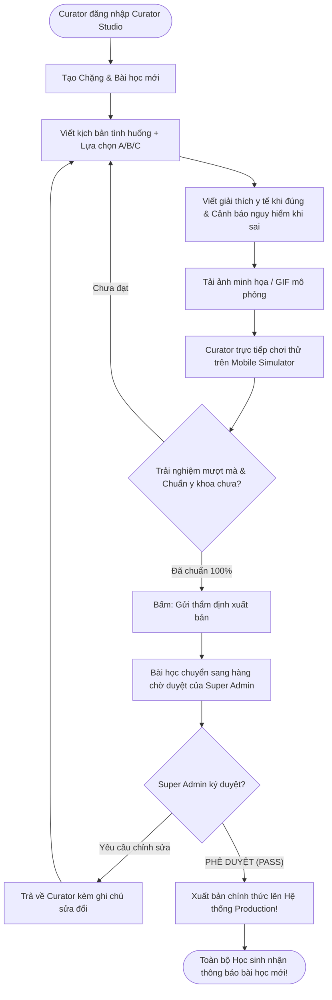

# TÀI LIỆU ĐẶC TẢ CHI TIẾT PHÂN HỆ: CHUYÊN GIA BIÊN SOẠN (CURATOR STUDIO)
## NỀN TẢNG HỌC KỸ NĂNG SỐNG & AN TOÀN GAMIFIED — MIMO PLATFORM

> **Dự án:** EXE201 — Khởi nghiệp & Phát triển Sản phẩm  
> **Phân hệ:** Xưởng Sáng tạo & Biên tuyển Nội dung (Curator Studio / Content Portal)  
> **Đối tượng sử dụng:** Giảng viên Kỹ năng sống, Bác sĩ Sơ cấp cứu, Chuyên gia Cứu nạn PCCC, Chuyên gia An toàn số  
> **Mục tiêu:** Cung cấp môi trường trực quan giúp các chuyên gia dễ dàng "đóng gói" kiến thức sinh tồn phức tạp thành các kịch bản tương tác game hóa sinh động, thẩm định chất lượng y khoa và tối ưu hóa bài giảng dựa trên dữ liệu người học.

---

## MỤC LỤC
1. [BẢN CHẤT VAI TRÒ CỦA CONTENT CURATOR TRONG MIMO](#1-bản-chất-vai-trò-của-content-curator-trong-mimo)
2. [KIẾN TRÚC GIAO DIỆN CURATOR STUDIO](#2-kiến-trúc-giao-diện-curator-studio)
3. [MODULE 1: BẢN ĐỒ KỊCH BẢN & CÂY HỌC LIỆU (CONTENT REPOSITORY)](#3-module-1-bản-đồ-kịch-bản--cây-học-liệu-content-repository)
4. [MODULE 2: BỘ CÔNG CỤ SOẠN THẢO TÌNH HUỐNG TRỰC QUAN (SCENARIO VISUAL BUILDER)](#4-module-2-bộ-công-cụ-soạn-thảo-tình-huống-trực-quan-scenario-visual-builder)
5. [MODULE 3: KHO TÀI NGUYÊN ĐA PHƯƠNG TIỆN (MEDIA & ASSETS LIBRARY)](#5-module-3-kho-tài-nguyên-đa-phương-tiện-media--assets-library)
6. [MODULE 4: PHÂN TÍCH HIỆU QUẢ NỘI DUNG & ĐỘ KHÓ (CONTENT PERFORMANCE ANALYTICS)](#6-module-4-phân-tích-hiệu-quả-nội-dung--độ-khó-content-performance-analytics)
7. [MODULE 5: TRUNG TÂM PHẢN HỒI CHUYÊN MÔN (EXPERT REVIEW & FEEDBACK)](#7-module-5-trung-tâm-phản-hồi-chuyên-môn-expert-review--feedback)
8. [QUY TRÌNH BIÊN SOẠN & PHÊ DUYỆT BÀI HỌC (CONTENT WORKFLOW)](#8-quy-trình-biên-soạn--phê-duyệt-bài-học-content-workflow)

---

## 1. BẢN CHẤT VAI TRÒ CỦA CONTENT CURATOR TRONG MIMO

### 1.1. Tại sao gọi là "Curator" mà không gọi đơn thuần là "Teacher"?
* **Teacher / Instructor truyền thống:** Thường đứng giảng giải lý thuyết, quay video bài giảng dài 30–45 phút hoặc tải slide PowerPoint lên mạng.
* **Content Curator trong MIMO:** Là **"Kiến trúc sư trải nghiệm tình huống"**. 
  * Họ không bắt học sinh ngồi nghe thụ động.
  * Họ làm công việc **chọn lọc tinh hoa (curate)**: Rút gọn các cẩm nang y tế/cứu nạn dày cộp thành những **tình huống mô phỏng đời thực 2–3 phút**.
  * Chịu trách nhiệm bảo đảm tính **chính xác y khoa và an toàn pháp luật 100%**: Mỗi giải thích đúng hay cảnh báo sai đều có cơ sở khoa học từ Hội Chữ Thập Đỏ, Cục Cảnh sát PCCC hoặc Cục An toàn thông tin.

### 1.2. Ranh giới Quyền hạn (Phân định rạch ròi với Admin)
* **Những gì Curator ĐƯỢC làm:**
  * Toàn quyền tạo, chỉnh sửa, thử nghiệm kịch bản bài học trong chuyên môn của mình (vd: Bác sĩ phụ trách Sơ cấp cứu; Cảnh sát PCCC phụ trách Thoát hiểm).
  * Xem báo cáo tỷ lệ học sinh làm đúng/sai từng câu hỏi để tối ưu lại lời giải thích.
  * Tiếp nhận các góp ý chuyên môn từ người học để cập nhật phác đồ mới.
* **Những gì Curator KHÔNG ĐƯỢC làm (Bảo mật của Admin):**
  * Không xem doanh thu tài chính, không can thiệp cổng thanh toán.
  * Không quản lý tài khoản người dùng, không can thiệp server hay hợp đồng B2B trường học.

---

## 2. KIẾN TRÚC GIAO DIỆN CURATOR STUDIO

Giao diện Curator Studio được thiết kế theo phong cách sáng tạo chuyên nghiệp, chia 2 vùng rõ ràng: **Thanh công cụ điều hướng bên trái** và **Không gian sáng tạo nội dung ở trung tâm**:

```
┌────────────────────────────────────────────────────────────────────────────────────────┐
│ 🩺 [CURATOR STUDIO] Chuyên gia: BS. Trần Hoàng Nam (Sơ cấp cứu)  🔍 Tìm kịch bản  🔔 [Avt]│
├───────────────────┬────────────────────────────────────────────────────────────────────┤
│ SIDEBAR (240px)   │ KHÔNG GIAN SÁNG TẠO & BIÊN SOẠN CHÍNH (CANVAS WORKSPACE)           │
├───────────────────┤                                                                    │
│ 📚 Kịch bản của tôi│  [TIÊU ĐỀ: CHẶNG 1 — SƠ CỨU BỎNG NHIỆT & NƯỚC SÔI]                 │
│ ✍️ Soạn tình huống │  Trạng thái: 🟢 Đã xuất bản (Live) • 14.250 Lượt học • 82% Tỷ lệ đú│
│ 🗄️ Thư viện Media │                                                                    │
│ 📈 Phân tích bài  │  ┌─────────────────────────────────┬─────────────────────────────┐ │
│ 💬 Góp ý y tế     │  │ BẢNG DANH SÁCH 5 TÌNH HUỐNG     │ TRÌNH GIẢ LẬP MOBILE PREVIEW│ │
│ 📜 Chuẩn biên soạn│  │ • TH 1: Bỏng nước sôi sinh hoạt │ ┌─────────────────────────┐ │ │
│                   │  │ • TH 2: Dầu ăn bốc cháy trên bếp│ │ [✕] ██████░░░░░   ❤️ 5  │ │ │
│                   │  │ • TH 3: Bỏng hóa chất tẩy rửa   │ │ 🤖 MIMO:                │ │ │
│                   │  │ • TH 4: Cắt bỏng điện gia dụng  │ │ "Khói đen cuồn cuộn..." │ │ │
│                   │  │ • TH 5: Thử thách Boss Chặng 1  │ │ [ 1 ] Tạt xô nước lạnh  │ │ │
│                   │  │                                 │ │ [ 2 ] Đậy nắp vung kim..│ │ │
│                   │  │ [+ THÊM TÌNH HUỐNG MỚI]         │ │ [ KIỂM TRA (3D) ]       │ │ │
│                   │  └─────────────────────────────────┴─────────────────────────────┘ │
└───────────────────┴────────────────────────────────────────────────────────────────────┘
```

---

## 3. MODULE 1: BẢN ĐỒ KỊCH BẢN & CÂY HỌC LIỆU (CONTENT REPOSITORY)

Giúp Curator quản lý cấu trúc học liệu theo 5 trụ cột kỹ năng mà mình được phân công:

### 3.1. Phân cấp Học liệu Trực quan
* **Chủ đề lớn (Domain):** Ví dụ `🚑 Sơ cấp cứu ban đầu`.
* **Chặng học (Unit):** Ví dụ `Chặng 1: Bỏng nhiệt và vết thương hở`.
* **Bài học (Lesson):** Ví dụ `Bài 1.1: Sơ cứu bỏng nước sôi cấp độ 1 & 2`.
* **Tình huống mô phỏng (Scenario Question):** Từng lát cắt ra quyết định 30 giây trong bài học.

### 3.2. Bảng Theo dõi Trạng thái Vòng đời Kịch bản
* 🟡 **Bản nháp (Draft):** Kịch bản đang được Curator viết dở dang, chưa ai nhìn thấy ngoài tác giả.
* 🟠 **Chờ kiểm duyệt (Pending Review):** Đã hoàn thiện, đang gửi Admin và Hội đồng Y khoa thẩm định.
* 🟢 **Đã xuất bản (Published/Live):** Đang hoạt động trên ứng dụng cho hàng chục ngàn học sinh trải nghiệm.
* 🔴 **Cần cập nhật (Needs Revision):** Bị báo lỗi hoặc phác đồ y tế cũ cần chỉnh sửa lại.

---

## 4. MODULE 2: BỘ CÔNG CỤ SOẠN THẢO TÌNH HUỐNG TRỰC QUAN (SCENARIO VISUAL BUILDER)

Đây là **công cụ cốt lõi nhất** của Curator Studio, cho phép chuyên gia tạo kịch bản với đầy đủ hình ảnh, phản hồi đúng/sai và hiệu ứng game.

```
┌────────────────────────────────────────────────────────────────────────┐
│ BỘ SOẠN THẢO TÌNH HUỐNG: TH 2 — DẦU ĂN BÙNG CHÁY TRÊN BẾP              │
├────────────────────────────────────────────────────────────────────────┤
│ 1. CHỌN DẠNG TƯƠNG TÁC (EXERCISE TYPE):                                │
│    [●] Quyết định tình huống (Scenario Choice A/B/C)                   │
│    [○] Sắp xếp quy trình cứu nạn (Sequencing Steps)                    │
│    [○] Vạch lá tìm sâu (Spot the Red Flag)                             │
│    [○] Đúng / Sai phản xạ nhanh (Rapid True/False)                     │
│                                                                        │
│ 2. NGỮ CẢNH DẪN DẮT (STORYLINE CONTEXT):                               │
│    "Bạn đang chiên khoai tây trong bếp thì dầu ăn bất ngờ bốc cháy     │
│     dữ dội, ngọn lửa bén cao gần chạm vào máy hút mùi!"                │
│                                                                        │
│ 3. MEDIA MINH HỌA (HÌNH ẢNH / GIF KHẨN CẤP):                           │
│    [Ảnh: chao_dau_boc_chay.jpg]   [ Thay đổi ]  [ Xem kích thước chuẩn]│
│                                                                        │
│ 4. CÂU HỎI HÀNH ĐỘNG:                                                  │
│    "HÀNH ĐỘNG ĐẦU TIÊN BẠN NÊN LÀM LÀ GÌ?"                             │
│                                                                        │
│ 5. THIẾT LẬP CÁC LỰA CHỌN & PHẢN HỒI CHUYÊN MÔN:                       │
│    ──────────────────────────────────────────────────────────────────  │
│    • LỰA CHỌN A: "Tạt ngay một xô nước lạnh vào chảo"                  │
│      - Trạng thái: [ ĐÁP ÁN SAI ❌ ]                                   │
│      - Cảnh báo hậu quả: "Nước nặng hơn dầu sẽ chìm xuống đáy bốc hơi  │
│        tức thì, tạo vụ nổ cầu lửa thiêu rụi toàn bộ gian bếp trong 2s!"│
│    ──────────────────────────────────────────────────────────────────  │
│    • LỰA CHỌN B: "Dùng nắp vung kim loại đậy kín miệng chảo và tắt bếp"│
│      - Trạng thái: [ ĐÁP ÁN ĐÚNG ✅ ]                                  │
│      - Giải thích khoa học: "Đậy nắp vung giúp cách ly hoàn toàn oxy   │
│        khiến lửa tự tắt ngay mà không gây bắn dầu nguy hiểm."          │
│    ──────────────────────────────────────────────────────────────────  │
│    • LỰA CHỌN C: "Bê chảo dầu đang cháy chạy nhanh ra ban công"        │
│      - Trạng thái: [ ĐÁP ÁN SAI ❌ ]                                   │
│      - Cảnh báo hậu quả: "Di chuyển chảo dầu đang sôi dễ làm sóng dầu  │
│        trào vào tay gây bỏng cấp độ 3 và cháy lan sang đồ đạc khác!"   │
│                                                                        │
│ 6. CẤU HÌNH THỜI GIAN & ĐIỂM:                                          │
│    • Đếm ngược khẩn cấp: [ 15 giây ] (Tạo áp lực ra quyết định nhanh)  │
│    • Điểm XP nhận được: [ 15 XP ]                                      │
│                                                                        │
│ [ CHẠY THỬ NGHIỆM TRÊN MOBILE SIMULATOR ]         [ LƯU & GỬI DUYỆT ]  │
└────────────────────────────────────────────────────────────────────────┘
```

### 4.1. Trình Giả lập Điện thoại Tương tác Thời gian thực (Live Mobile Simulator)
* Nằm song song bên cạnh màn hình soạn thảo.
* Curator có thể **bấm thử nghiệm trực tiếp** như một học sinh thật:
  * Bấm thử đáp án A để xem khay phản hồi màu đỏ trượt lên trông có đẹp mắt không.
  * Bấm thử đáp án B để nghe tiếng chuông chúc mừng và đọc lại giải thích khoa học.
  * Thao tác này giúp Curator phát hiện câu chữ quá dài gây tràn màn hình điện thoại nhỏ.

---

## 5. MODULE 3: KHO TÀI NGUYÊN ĐA PHƯƠNG TIỆN (MEDIA & ASSETS LIBRARY)

Một kịch bản kỹ năng sống chỉ thực sự cuốn hút khi có hình ảnh mô phỏng chân thực:

* **Quản lý Thư viện Ảnh & GIF:**
  * Thư mục phân loại: *Sơ cấp cứu (vết thương, bỏng), PCCC (bình cứu hỏa, khói độc, lối thoát), An toàn số (ảnh chụp tin nhắn lừa đảo SMS/Zalo)*.
  * Định dạng tối ưu: Ảnh WebP dung lượng nhẹ (<150KB) giúp app tải nhanh trong 0.5 giây.
* **Bộ quy chuẩn hình ảnh an toàn (Safety Imagery Guidelines):**
  * Không dùng hình ảnh rùng rợn, máu me gây ám ảnh tâm lý học sinh.
  * Sử dụng hình vẽ minh họa bán thực tế (Stylized Realism) hoặc đồ họa vector 3D thân thiện, trực quan.

---

## 6. MODULE 4: PHÂN TÍCH HIỆU QUẢ NỘI DUNG & ĐỘ KHÓ (CONTENT PERFORMANCE ANALYTICS)

Curator không "soạn bài xong rồi bỏ đó". Hệ thống cung cấp số liệu phản hồi từ hàng ngàn học sinh để Curator liên tục nâng cấp chất lượng kịch bản:

```
┌────────────────────────────────────────────────────────────────────────┐
│ PHÂN TÍCH HIỆU QUẢ BÀI HỌC: SƠ CỨU BỎNG NƯỚC SÔI                       │
├────────────────────────────────────────────────────────────────────────┤
│ • Tổng lượt học sinh tham gia:                     18.420 lượt         │
│ • Điểm đánh giá độ hữu ích:                        4.9 / 5.0 ⭐        │
│ • Tỷ lệ hoàn thành toàn bộ bài học:                91% (Rất cao)       │
├────────────────────────────────────────────────────────────────────────┤
│ BIỂU ĐỒ TỶ LỆ TRẢ LỜI ĐÚNG / SAI TỪNG CÂU HỎI TRONG BÀI:               │
│                                                                        │
│ Câu 1: Xác định bỏng cấp độ 1       ██████████████████░░ 88% ĐÚNG 🟢   │
│ Câu 2: Có nên bôi kem đánh răng?    █████░░░░░░░░░░░░░░░ 28% ĐÚNG 🔴   │
│ Câu 3: Thời gian xả nước mát        ██████████████░░░░░░ 72% ĐÚNG 🟡   │
│ Câu 4: Cách băng vết bỏng hở        ████████████████░░░░ 81% ĐÚNG 🟢   │
├────────────────────────────────────────────────────────────────────────┤
│ 💡 PHÂN TÍCH CHUYÊN GIA TỰ ĐỘNG:                                       │
│ "Câu số 2 có tỷ lệ sai lên tới 72%. Đa số học sinh chọn nhầm phương    │
│ án bôi mỡ trăn. Đề xuất Curator bổ sung thêm 1 câu hỏi làm rõ sự khác   │
│ biệt giữa vết bỏng mới và vết bỏng đã khô để học sinh hiểu sâu hơn!"  │
└────────────────────────────────────────────────────────────────────────┘
```

* **Chỉ số Độ khó Thực tế (Empirical Difficulty):** Hệ thống tự động gán nhãn bài học là *Dễ, Trung bình, hay Khó* dựa trên tỷ lệ vượt qua thực tế của cộng đồng học viên, giúp tránh việc bài học quá khó gây ức chế hoặc quá dễ gây nhàm chán.

---

## 7. MODULE 5: TRUNG TÂM PHẢN HỒI CHUYÊN MÔN (EXPERT REVIEW & FEEDBACK)

Cầu nối trực tiếp giữa **Chuyên gia y tế/an toàn** và **Cộng đồng người học**:

* **Tiếp nhận Góp ý Nội dung Chuyên sâu:**
  * Khi học sinh hoặc giáo viên bấm nút *"Góp ý chuyên môn"*:
    * Ví dụ: *"Thưa chuyên gia, thao tác ép tim trong bài 3 khuyến cáo ép 100 lần/phút, nhưng tài liệu mới của Hội Hồi sức Cấp cứu khuyến cáo 100–120 lần/phút"*.
* **Cơ chế Thẩm định Chéo (Peer Review):**
  * Các Curator trong cùng hội đồng (ví dụ 2 bác sĩ khác nhau) có thể đọc bài của nhau và để lại bình luận nhận xét nội bộ trước khi gửi bài cho Super Admin xuất bản.

---

## 8. QUY TRÌNH BIÊN SOẠN & PHÊ DUYỆT BÀI HỌC (CONTENT WORKFLOW)



---

*Tài liệu đặc tả này hoàn thiện mảnh ghép thứ hai trong chuỗi vận hành chuyên môn của MIMO. Curator Studio mang đến cho các bác sĩ, chuyên gia an toàn và giảng viên một không gian làm việc chuyên biệt, độc lập và đẳng cấp để sáng tạo nên những bài học cứu sống con người trong thực tế.*
