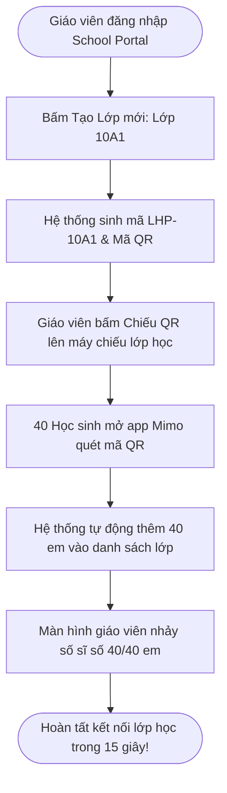
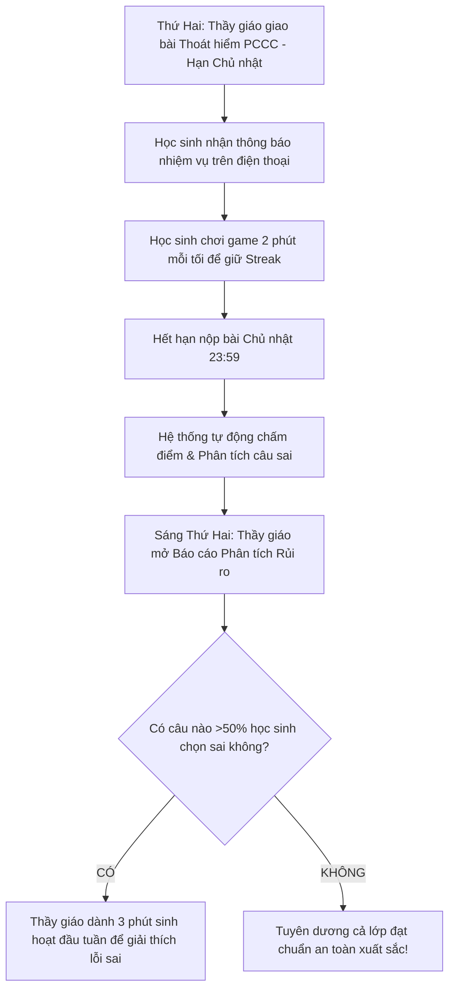
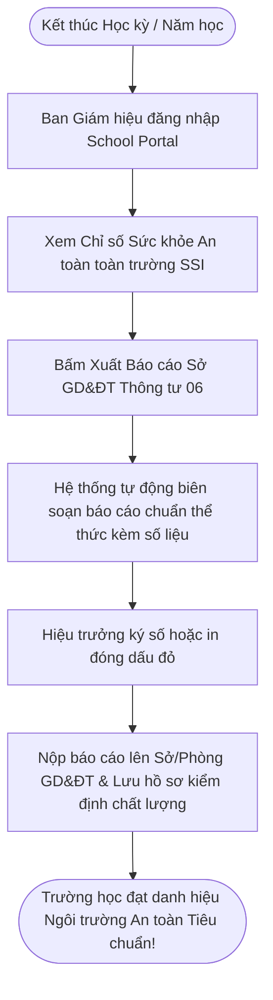

# TÀI LIỆU ĐẶC TẢ CHI TIẾT PHÂN HỆ: NHÀ TRƯỜNG & GIÁO VIÊN (SCHOOL & EDUCATOR B2B)
## NỀN TẢNG HỌC KỸ NĂNG SỐNG & AN TOÀN GAMIFIED — MIMO PLATFORM

> **Dự án:** EXE201 — Khởi nghiệp & Phát triển Sản phẩm  
> **Phân hệ:** Cổng thông tin Nhà trường & Giáo viên (School Portal / Educator B2B)  
> **Đối tượng sử dụng:** Ban Giám hiệu, Giáo viên chủ nhiệm, Giáo viên kỹ năng sống / Hoạt động trải nghiệm  
> **Mục tiêu:** Cung cấp công cụ quản lý lớp học, giao bài tập tình huống an toàn, đo lường phản xạ học sinh và xuất báo cáo đạt chuẩn gửi Sở/Phòng Giáo dục & Đào tạo.

---

## MỤC LỤC
1. [BỐI CẢNH & GIÁ TRỊ CỐT LÕI DÀNH CHO NHÀ TRƯỜNG](#1-bối-cảnh--giá-trị-cốt-lõi-dành-cho-nhà-trường)
2. [CÁC CẤP QUYỀN TRONG NHÀ TRƯỜNG (SCHOOL ROLES)](#2-các-cấp-quyền-trong-nhà-trường-school-roles)
3. [KIẾN TRÚC GIAO DIỆN SCHOOL PORTAL](#3-kiến-trúc-giao-diện-school-portal)
4. [MODULE 1: BẢNG TỔNG QUAN CHỈ SỐ AN TOÀN HỌC ĐƯỜNG (SAFETY INDEX)](#4-module-1-bảng-tổng-quan-chỉ-số-an-toàn-học-đường-safety-index)
5. [MODULE 2: QUẢN LÝ LỚP HỌC & HỌC SINH (ROSTER & CLASS CODE)](#5-module-2-quản-lý-lớp-học--học-sinh-roster--class-code)
6. [MODULE 3: TRUNG TÂM GIAO BÀI TẬP KỸ NĂNG (ASSIGNMENT CENTER)](#6-module-3-trung-tâm-giao-bài-tập-kỹ-năng-assignment-center)
7. [MODULE 4: BÁO CÁO PHÂN TÍCH RỦI RO & ĐIỂM LIỆT (RISK ANALYTICS)](#7-module-4-báo-cáo-phân-tích-rủi-ro--điểm-liệt-risk-analytics)
8. [MODULE 5: BẢNG THI ĐUA LIÊN LỚP (INTER-CLASS LEADERBOARDS)](#8-module-5-bảng-thi-đua-liên-lớp-inter-class-leaderboards)
9. [MODULE 6: XUẤT BÁO CÁO CHÍNH QUY & CẤP CHỨNG NHẬN (CERTIFICATION)](#9-module-6-xuất-báo-cáo-chính-quy--cấp-chứng-nhận-certification)
10. [CÁC LUỒNG NGHIỆP VỤ THỰC TẾ TẠI TRƯỜNG HỌC](#10-các-luồng-nghiệp-vụ-thực-tế-tại-trường-học)

---

## 1. BỐI CẢNH & GIÁ TRỊ CỐT LÕI DÀNH CHO NHÀ TRƯỜNG

### 1.1. Nỗi đau lớn của Nhà trường hiện nay (The Problem)
* **Quy định bắt buộc:** Theo Thông tư 06/2022/TT-BGDĐT của Bộ GD&ĐT, các trường từ Tiểu học đến THPT bắt buộc phải đưa kiến thức PCCC, cứu nạn cứu hộ và kỹ năng an toàn vào chương trình học chính khóa hoặc tiết Hoạt động trải nghiệm.
* **Thực trạng bế tắc:**
  * Giáo viên không có chuyên môn y tế / cứu hỏa / an ninh mạng để đứng lớp giảng dạy chuyên sâu.
  * Mỗi năm chỉ tổ chức được 1–2 buổi diễn tập tập trung ngoài sân trường rất tốn kém; học sinh đứng xem đông đúc rồi quên ngay.
  * Nhà trường **hoàn toàn không có dữ liệu để biết bao nhiêu % học sinh thực sự biết cách thoát hiểm** khi sự cố xảy ra.

### 1.2. Giải pháp Đột phá từ MIMO (The B2B Value Proposition)
MIMO giải quyết triệt để bài toán này chỉ với **chi phí cực thấp (15.000đ – 20.000đ/học sinh/năm)**:
* **Không làm phiền giáo viên:** Giáo viên không cần soạn bài giảng; ngân hàng tình huống mô phỏng chuẩn y khoa đã có sẵn trên app.
* **Học sinh tự giác học:** Nhờ cơ chế game hóa (Streak, XP, Leagues), học sinh hào hứng học 2–3 phút mỗi ngày như chơi game.
* **Đo lường thời gian thực:** Cung cấp cho Ban Giám hiệu báo cáo số liệu chính xác từng lớp, từng học sinh để nộp lên Sở/Phòng GD&ĐT.

---

## 2. CÁC CẤP QUYỀN TRONG NHÀ TRƯỜNG (SCHOOL ROLES)

```
┌────────────────────────────────────────────────────────────────────────┐
│                        PHÂN QUYỀN TRONG NHÀ TRƯỜNG                     │
└────────────────────────────────────────────────────────────────────────┘
                    │                                │
                    ▼                                ▼
       [ 🏛️ BAN GIÁM HIỆU / HIỆU TRƯỞNG ]     [ 👨‍🏫 GIÁO VIÊN CHỦ NHIỆM / BỘ MÔN ]
       • Xem chỉ số toàn trường (K10, K11, K12) • Quản lý lớp học cụ thể (vd: 10A1)
       • So sánh tỷ lệ an toàn giữa các khối   • Sinh mã lớp / Chiếu QR lên bảng
       • Xuất báo cáo gửi Sở GD&ĐT (PDF/Excel)  • Giao bài tập tình huống tuần
       • Quản trị hợp đồng bản quyền trường    • Xem danh sách học sinh làm sai
```

1. **🏛️ Ban Giám hiệu / Hiệu trưởng (Principal Admin):** Quản trị cấp vĩ mô toàn trường, giám sát tiến độ các khối lớp, duyệt và ký xuất báo cáo an toàn học đường.
2. **👨‍🏫 Giáo viên Chủ nhiệm / Giáo viên Bộ môn (Teacher / Educator):** Quản lý trực tiếp 1 hoặc nhiều lớp học. Giao nhiệm vụ kỹ năng tuần, nhắc nhở học sinh lười học và sử dụng kết quả để nhận xét trong tiết sinh hoạt lớp.

---

## 3. KIẾN TRÚC GIAO DIỆN SCHOOL PORTAL

Giao diện School Portal được tối ưu hóa cho Desktop và Tablet, bố cục trực quan, font chữ dễ đọc, không đòi hỏi kỹ năng tin học phức tạp:

```
┌────────────────────────────────────────────────────────────────────────────────────────┐
│ 🏫 [THPT CHUYÊN LÊ HỒNG PHONG]  Học kỳ 1 • 2026-2027      🔍 Tìm kiếm HS  🔔 [Thầy Nam]│
├───────────────────┬────────────────────────────────────────────────────────────────────┤
│ SIDEBAR (240px)   │ KHÔNG GIAN BÁO CÁO & ĐIỀU HÀNH CHÍNH (MAIN WORKSPACE)              │
├───────────────────┤                                                                    │
│ 📊 Chỉ số An toàn │  [THẺ TỔNG QUAN: CHỈ SỐ SSI 84/100 • 1.420 HS • 92% ĐÃ ĐẠT CHUẨN]   │
│ 🏫 Lớp học của tôi│                                                                    │
│ 🎯 Giao bài tập   │  [BIỂU ĐỒ HOÀN THÀNH KỸ NĂNG: PCCC 95% • SƠ CỨU 78% • SCAM 88%]    │
│ ⚠️ Cảnh báo Rủi ro│                                                                    │
│ 🏆 Thi đua Lớp học│  [DANH SÁCH BÀI TẬP ĐANG CHẠY: "TUẦN 3: XỬ LÝ CHÁY CHUNG CƯ" (82%)]│
│ 📄 Xuất báo cáo   │                                                                    │
│ ⚙️ Cài đặt trường │  [BẢNG CẢNH BÁO 8 HỌC SINH LỚP 10A1 CHỌN SAI CÁCH DẬP LỬA XĂNG DẦU] │
└───────────────────┴────────────────────────────────────────────────────────────────────┘
```

---

## 4. MODULE 1: BẢNG TỔNG QUAN CHỈ SỐ AN TOÀN HỌC ĐƯỜNG (SAFETY INDEX)

Màn hình đầu tiên cung cấp cho Hiệu trưởng và Giáo viên bức tranh toàn cảnh về "hệ miễn dịch an toàn" của trường:

### 4.1. Chỉ số Sức khỏe An toàn Học đường (School Safety Index - SSI)
* **Điểm SSI toàn trường:** Điểm số từ `0 đến 100` tổng hợp từ 3 yếu tố:
  * Tỷ lệ học sinh tham gia học đều đặn (Activity Rate).
  * Điểm trung bình giải quyết đúng tình huống khẩn cấp (Accuracy Rate).
  * Tỷ lệ hoàn thành các bài test Boss chuyên đề (Mastery Rate).
* **Xếp loại:** `84/100 ➔ Hạng Xuất Sắc (Trường học An toàn Đạt chuẩn)`.

---

### 4.2. Bảng Đồng hồ Đo lường theo 5 Trụ cột Kỹ năng
Hiển thị trực quan dưới dạng thanh đo phần trăm (Progress Bars) hoặc biểu đồ mạng nhện (Radar Chart):
* 🚑 **Sơ cấp cứu cơ bản:** `78% học sinh đạt chuẩn`
* 🔥 **PCCC & Thoát hiểm:** `95% học sinh đạt chuẩn` *(Điểm sáng nhờ chuyên đề tháng 10)*
* 🚦 **An toàn giao thông & Điểm mù xe tải:** `86% học sinh đạt chuẩn`
* 🛡️ **An toàn số & Chống lừa đảo online:** `88% học sinh đạt chuẩn`
* 🤝 **Phòng chống bạo lực học đường:** `92% học sinh đạt chuẩn`

---

## 5. MODULE 2: QUẢN LÝ LỚP HỌC & HỌC SINH (ROSTER & CLASS CODE)

Giúp giáo viên quản lý danh sách học sinh cực kỳ nhanh chóng mà không cần nhập liệu thủ công từng em:

```
┌────────────────────────────────────────────────────────────────────────┐
│ QUẢN LÝ LỚP: 10A1 (Sĩ số: 42 Học sinh)          MÃ LỚP: [ LHP-10A1 ]   │
├────────────────────────────────────────────────────────────────────────┤
│ [ 📱 CHIẾU MÃ QR LÊN MÀN HÌNH ]             [ 📥 XUẤT DANH SÁCH EXCEL ]│
├────┬──────────────────┬──────────────┬──────────────┬──────────────────┤
│ STT│ Họ và Tên        │ Chuỗi Streak │ Điểm XP Tuần │ Trạng thái tuần  │
├────┼──────────────────┼──────────────┼──────────────┼──────────────────┤
│ 1  │ Nguyễn Văn An    │ 🔥 14 ngày   │ 350 XP       │ ✅ Đã nộp bài (100)│
│ 2  │ Trần Thị Mai     │ 🔥 21 ngày   │ 420 XP       │ ✅ Đã nộp bài (90) │
│ 3  │ Lê Hoàng Nam     │ ⚪ 0 ngày    │ 40 XP        │ ⚠️ CHƯA HỌC TUẦN NÀY│
│ 4  │ Phạm Quốc Bảo    │ 🔥 7 ngày    │ 180 XP       │ ⏳ Đang làm dở   │
└────┴──────────────────┴──────────────┴──────────────┴──────────────────┤
│ [ GỬI THÔNG BÁO NHẮC NHỞ CHO 5 HỌC SINH CHƯA NỘP BÀI ]                 │
└────────────────────────────────────────────────────────────────────────┘
```

### 5.1. Cơ chế Tạo lớp & Tham gia Một chạm (Instant Join)
* **Sinh Mã Lớp tự động:** Giáo viên bấm nút tạo lớp ➔ Hệ thống sinh mã 6 ký tự (vd: `LHP-10A1`).
* **Màn hình Chiếu Mã QR (Classroom Presentation Mode):**
  * Trong tiết sinh hoạt lớp, giáo viên bấm nút "Chiếu QR" ➔ Màn hình phóng to mã QR và hướng dẫn 3 bước lên máy chiếu/TV của lớp.
  * Học sinh chỉ cần mở app MIMO ➔ Quét mã QR ➔ 100% học sinh vào lớp chỉ trong vòng **15 giây**!

### 5.2. Quản lý Danh sách & Gửi Nhắc nhở (One-click Reminder)
* Giáo viên nhìn thấy ngay học sinh nào đang duy trì chuỗi Streak tốt, học sinh nào bỏ bê.
* Nút bấm tiện ích: **"Nhắc nhở học sinh chưa làm bài"** ➔ Tự động gửi thông báo đẩy (Push notification) về điện thoại của học sinh: *"Thầy Nam nhắc bạn: Hạn chót bài tập Thoát hiểm hỏa hoạn là 23:59 Chủ nhật này!"*.

---

## 6. MODULE 3: TRUNG TÂM GIAO BÀI TẬP KỸ NĂNG (ASSIGNMENT CENTER)

Giáo viên không cần tốn hàng giờ soạn đề kiểm tra. Toàn bộ kịch bản chuẩn hóa đã được đội ngũ chuyên gia MIMO tích hợp sẵn:

```
┌────────────────────────────────────────────────────────────────────────┐
│ TẠO NHIỆM VỤ KỸ NĂNG MỚI CHO LỚP                                       │
├────────────────────────────────────────────────────────────────────────┤
│ 1. CHỌN CHUYÊN ĐỀ KỸ NĂNG:                                             │
│    [▼ Thoát hiểm & PCCC                                              ] │
│                                                                        │
│ 2. CHỌN BÀI HỌC ÁP DỤNG:                                               │
│    [●] Bài 1: Thoát hiểm khi có khói độc chung cư cao tầng             │
│    [●] Bài 2: Nhận biết và xử lý rò rỉ khí gas                         │
│                                                                        │
│ 3. ĐỐI TƯỢNG GIAO BÀI:                                                 │
│    [●] Lớp 10A1    [○] Lớp 10A2    [○] Toàn bộ Khối 10                │
│                                                                        │
│ 4. THỜI HẠN HOÀN THÀNH (DEADLINE):                                     │
│    Ngày: [ 18/10/2026 ]   Giờ: [ 23:59 ]                               │
│                                                                        │
│ 5. YÊU CẦU ĐẠT CHUẨN:                                                  │
│    Học sinh phải đạt tối thiểu: [ 80% ] điểm số (Được làm lại nếu trượt│
│                                                                        │
│ [ HỦY ]                                           [ PHÁT LỆNH GIAO BÀI]│
└────────────────────────────────────────────────────────────────────────┘
```

### Quy trình Giao bài trong 3 bước:
1. **Bước 1:** Chọn chủ đề và bài học có sẵn trong thư viện MIMO.
2. **Bước 2:** Chọn lớp cần giao và đặt hạn chót (thường là cuối tuần).
3. **Bước 3:** Bấm **"Phát lệnh Giao bài"** ➔ Toàn bộ học sinh trong lớp nhận được thông báo nhiệm vụ mới trên ứng dụng.

---

## 7. MODULE 4: BÁO CÁO PHÂN TÍCH RỦI RO & ĐIỂM LIỆT (RISK ANALYTICS)

Đây là **tính năng "đắt giá nhất"** giúp trường học nhìn thấy những lỗ hổng chết người trong nhận thức của học sinh:

```
┌────────────────────────────────────────────────────────────────────────┐
│ PHÂN TÍCH LỖ HỔNG KIẾN THỨC — LỚP 10A1 (BÀI TẬP TUẦN 3)                │
├────────────────────────────────────────────────────────────────────────┤
│ TÌNH HUỐNG SỐ 2: "CHẢO DẦU ĐANG NẤU BÙNG CHÁY TRÊN BẾP"                │
├────────────────────────────────────────────────────────────────────────┤
│ • Số học sinh làm đúng (Đậy nắp vung/khăn ẩm):    12 / 42 em (28%) 🟢  │
│ • Số học sinh CHỌN SAI (Tạt xô nước lạnh):         30 / 42 em (72%) 🔴 │
├────────────────────────────────────────────────────────────────────────┤
│ 💡 GỢI Ý HÀNH ĐỘNG CHO GIÁO VIÊN:                                      │
│ "Có tới 72% học sinh lớp 10A1 vẫn có thói quen tạt nước vào đám cháy   │
│ dầu mỡ (hành vi gây nổ cầu lửa cực kỳ nguy hiểm).                      │
│ Thầy/Cô hãy dành 3 phút đầu giờ sinh hoạt lớp thứ Hai để nhấn mạnh lại  │
│ nguyên tắc tuyệt đối không tạt nước vào dầu mỡ!"                       │
└────────────────────────────────────────────────────────────────────────┘
```

* **Cảnh báo học sinh có nguy cơ cao (At-risk Students):**
  * Danh sách các học sinh liên tục trả lời sai các câu hỏi an toàn sống còn.
  * Giáo viên có thể trao đổi riêng hoặc gửi cảnh báo cho phụ huynh để kèm cặp thêm ở nhà.

---

## 8. MODULE 5: BẢNG THI ĐUA LIÊN LỚP (INTER-CLASS LEADERBOARDS)

Biến việc học kỹ năng sống nhàm chán thành phong trào thi đua sôi nổi toàn trường:

```
┌────────────────────────────────────────────────────────────────────────┐
│ 🏆 BẢNG XẾP HẠNG PHONG TRÀO AN TOÀN HỌC ĐƯỜNG — THÁNG 10               │
├──────┬──────────┬──────────────┬──────────────┬────────────────────────┤
│ Hạng │ Lớp      │ GV Chủ nhiệm │ Tỷ lệ Nộp bài│ Tổng XP Phong trào     │
├──────┼──────────┼──────────────┼──────────────┼────────────────────────┤
│ 🥇 1 │ Lớp 10A1 │ Thầy Nam     │ 100%         │ 18.450 XP (Dẫn đầu 👑) │
│ 🥈 2 │ Lớp 10A4 │ Cô Lan       │ 97%          │ 16.200 XP              │
│ 🥉 3 │ Lớp 10A2 │ Thầy Bình    │ 95%          │ 15.800 XP              │
│ 4    │ Lớp 10A3 │ Cô Hương     │ 81%          │ 11.200 XP              │
└──────┴──────────┴──────────────┴──────────────┴────────────────────────┤
│ [ XUẤT GIẤY KHEN VÀ TUYÊN DƯƠNG LỚP DẪN ĐẦU TRONG TIẾT CHÀO CỜ ]       │
└────────────────────────────────────────────────────────────────────────┘
```
* **Khen thưởng tiết Chào cờ đầu tuần:** Nhà trường lấy dữ liệu từ bảng xếp hạng MIMO để tuyên dương lớp đạt giải Nhất phong trào an toàn, trao cờ luân lưu. Điều này thúc đẩy học sinh tự nhắc nhau vào app duy trì Streak để lớp mình không bị tụt hạng.

---

## 9. MODULE 6: XUẤT BÁO CÁO CHÍNH QUY & CẤP CHỨNG NHẬN (CERTIFICATION)

Phân hệ giải quyết bài toán thủ tục hành chính phức tạp nhất của Ban Giám hiệu:

### 9.1. Xuất Hồ sơ Báo cáo An toàn Học đường (Audit Report PDF)
* Bấm 1 nút ➔ Hệ thống tự động biên soạn tập tài liệu chính quy định dạng PDF chuẩn thể thức văn bản nhà nước:
  * Quốc hiệu, tiêu ngữ, tên trường, số hiệu báo cáo.
  * Biểu đồ tỷ lệ 100% học sinh đã qua đào tạo PCCC theo Thông tư 06 của Bộ GD&ĐT.
  * Danh sách phân loại mức độ sẵn sàng ứng phó sự cố theo từng khối lớp.
  * **Chữ ký số của Hiệu trưởng & Đóng dấu xác nhận của nền tảng MIMO.**
* Hiệu trưởng chỉ việc in ra hoặc gửi file PDF trực tiếp lên **Sở Giáo dục & Đào tạo** và **Công an PCCC địa phương** khi có đoàn kiểm tra định kỳ.

---

### 9.2. Cấp Chứng chỉ Kỹ năng Sống Cá nhân (Student Safety Certificate)
* Khi học sinh hoàn thành toàn bộ 5 chuyên đề cốt lõi trong năm học:
  * Hệ thống tự động ghép họ tên học sinh, lớp, năm học vào phôi chứng chỉ chuẩn quốc tế.
  * Đóng dấu chứng nhận: *"Đã hoàn thành xuất sắc Khóa Huấn luyện Kỹ năng sống & Phản xạ An toàn Khẩn cấp MIMO 2026"*.
  * Cho phép học sinh và phụ huynh tải về bản PDF sắc nét hoặc chia sẻ lên Facebook để tự hào khoe thành tích.

---

## 10. CÁC LUỒNG NGHIỆP VỤ THỰC TẾ TẠI TRƯỜNG HỌC

### 10.1. Luồng Bắt đầu Tiết học: Tạo lớp & Học sinh tham gia trong 1 phút



---

### 10.2. Luồng Vận hành Hàng tuần: Giao bài & Sinh hoạt lớp



---

### 10.3. Luồng Cuối kỳ: Ban Giám hiệu Xuất Báo cáo Sở GD&ĐT



---

*Bộ tài liệu đặc tả này hoàn thiện trọn vẹn kiềng 3 chân của hệ thống MIMO: **Người học (Learner) — Nhà trường (Educator B2B) — Quản trị viên (Admin)**. Đây là tài liệu nền tảng mang tính thuyết phục tuyệt đối để nhóm tự tin bảo vệ mô hình kinh doanh và sản phẩm trước hội đồng thẩm định EXE201.*
